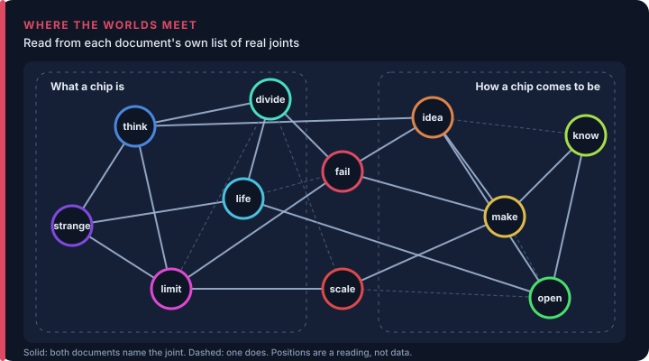

# What came out of filling the eleven

The eleven worlds were each written from first principles, in the same twelve sections, without deciding in
advance how content or challenges should be organized. Reading across them afterwards, a structure is visible that
nobody put there. This page writes it down. Nothing here is a rule yet; it is what the filled skeleton shows.

| | Count |
| --- | --- |
| Words | about 19,700 across eleven documents |
| First principles ("What is true") | 92, eight or nine per world |
| Questions inside | 103, eight to eleven per world |
| Challenges | 52, four to six per world |
| Sourced links | 58 |
| Engines | 11: 5 exist, 3 in part, 3 missing |
| Visual systems | 11: 4 drawn on the site, 7 new or partly drawn |

## 1. The unit is a truth, not a topic

Every world came out the same shape: a handful of truths (a switch is controlled by a voltage; moving a number costs
more than computing with it; a speck ruins only the chip it lands on), and around each truth:

- one or more **questions inside**, each one that truth met at a place ("Memory and logic sit apart. Was separating
  them a mistake?"), with the truth as its "something true to notice";
- a **challenge**, where an engine lets you push against the truth and see it hold;
- sometimes a **real case**, where the truth was learned the hard way.

So the thread the first version of the lab lacked is this: **a world is a few truths about chips; each truth is met
as a question somewhere, tested as a challenge, and remembered through a case.** The earlier forty topics were
organized by subject (lithography, memory, yield); the truths cut across subjects, which is why the topics never
connected.

## 2. Connections are shared truths

The only connections written were the ones each document found real, in its "Where it meets other questions". They
turn out to be truths with a home in one world that another world needs:

| Truth | Its home | Also needed by |
| --- | --- | --- |
| Moving a number costs more than computing with it | divide | think, life, limit |
| No test can try every case of a big circuit | limit | fail, idea |
| A speck ruins only the chip it lands on, so big chips come out broken more often | fail | divide, make |
| A part must have gain and a threshold for a 1 to survive a chain | strange | think |
| Erasing a bit has a physical price | limit | strange, think |
| The masks are where a design meets the factory | make | idea |
| Some of what makes a process work is not written down | know | make, open, idea |
| Making a chip costs mostly the same for ten copies as for ten million | open | idea, scale |

A truth has one home and is cited elsewhere, never rewritten. That is the lab's old rule ("nothing is written
twice"), applied to the right unit.

## 3. Two halves came out

Drawing the joints shows two groups that hardly touch, with two worlds between them:

- **What a chip is**: think, strange, limit, life, divide. Computing itself: its parts, its media, its limits, how
  it is organized.
- **How a chip comes to be**: idea, make, know, open. People turning ideas into things and sharing them.
- **Between them**: fail (a perfect design meets real making) and scale (physics and industry at once).

These are the two views the lab already had, found again from the questions: the dive (scale, inside the machine)
and the line (process, how it is made). The eleven questions do not replace them; they explain why both are needed
and why fail and scale are where they cross.

## 4. Challenges came out as four verbs

Sorting the 52 challenges by what you do in them, without forcing:

| Verb | What you do | Count | Examples |
| --- | --- | --- | --- |
| **Make** | reach a target the engine judges | 33 | only NAND; feed the cores; through a car's life; the order of steps |
| **Find** | find what is wrong, or what is true, in something given | 8 | find the broken copy; check the agent; strange or not; read the die |
| **Predict** | say what will happen, then see | 6 | one more item; cold that pays; forecast; the right medium |
| **Pass on** | make something another person (or AI) can use | 5 | the note; why each line; shelve it; move it |

And the community topics fall into the same four verbs: **make** (the open computer, designs, recipes, benchmarks),
**find** (break it), **predict** (forecasts, walls that fell), **pass on** (the strange shelf, handover, the shared
run). The lab itself as a swarm is the one topic about the community as a whole.

This is the joint between a visitor and the community that was missing: **a challenge is the practice form of a
community act, and a community act is a challenge done for real, kept in the record.** Fixing the half adder is
practice; designing a piece of the open computer is the same act, for real. Finding the broken copy is practice;
breaking someone's design is the same act, for real.

It also shows an imbalance: make is two thirds of everything. Find, predict and pass on, which are where a community
lives, are thin. The first version of the lab was built mostly of things to make.

## 5. Eleven of each held, by different routes

- **Visual systems:** one per world, and each turned out to lay out **one thing across the picture**: scale
  (dive), media (side by side), possibility (walls), copies over time (copies), forms of one design (forms), the
  order of making (line), tries (probe), dependence (map), space and flow (plan), many agents (swarm), time (clock).
  Eleven different axes, so they do not overlap.
- **Engines:** eleven, one per world, when each engine follows its world's question. The framework draft had
  fifteen; first principles merged some (timing and power into Work and Scaling, the core into Logic) and moved one
  out (the record is the community, not an engine). Logic and Design flow share their code, because think and
  idea look at the same description: one as a machine, one as a thing to be made.
- **Innovation directions:** one per world, each a small family of real bets with their catch.
- **Community topics:** eleven, but they are four verbs (above), not eleven kinds of thing.

## 6. What did not fit

- **Chips that touch the real world.** The first version had a topic on sensors, amplifiers, converters and power
  chips. None of the eleven questions holds it: they are all about computing. A chip also senses, measures, drives
  motors and handles power, and most chips by count do some of that. This may be a twelfth question, or a part of
  divide (where thinking ends and power begins). It is left open, not forced.
- **Chips everywhere.** A tour of the chips inside a phone, a car and a thermostat is a way in, not a world.
- **Your bench.** Testing real hardware is a way of doing (it belongs to find, in fail and open), not a world.
- **What can't be written down** has almost no earlier content and cannot be filled by the lab alone. That is a
  finding about the lab, not a gap to paper over.

## 7. What it suggests, without deciding

- The document version of the lab could be read **by truth**: each question inside leads to its truth, its
  challenge and its case, and to the worlds that cite it. The eleven questions stay the frame; a visitor enters
  through the 103 questions inside, never through a list of eleven.
- **Find, predict and pass on** need as much care as make, because they are where people and AI work together.
- The three missing engines (Process, Tune, Swarm) and the seven new visual systems are the build list, in the order
  their worlds need them.
