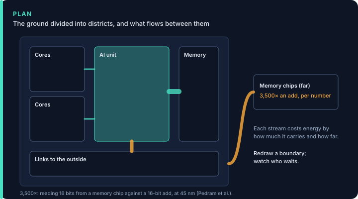

# How should a chip divide its work?

> **The question behind it:** how should any system divide its work: cells, companies, societies?

## Why it is open

**One general thing can do any job.** A processor runs any program, today and tomorrow. **Many special things, each
fast at one job, must keep talking**: a unit for graphics, one for AI, one for photos, memory beside each, chips
beside chips. Specialists are far faster and far more efficient at their one job; every boundary between them costs
energy and time to cross. Where to draw the boundaries has no fixed answer, because it depends on the jobs, and the
jobs keep changing.

## What is true

**1. Moving a number costs more than computing with it.** On a chip made in a 45-nanometre process, reading 16 bits
from a memory chip cost 640 picojoules; adding two 16-bit numbers cost 0.18: about 3,500 times less
([Pedram et al.](https://arxiv.org/pdf/1602.04183)). Newer chips are cheaper at both, and the gap stays large. Most
of the energy of a modern chip goes to moving data, not to arithmetic.

**2. Near is small, far is big.** A few numbers fit right beside the arithmetic, in registers; more fit in on-chip
memory a little further away; most live in memory chips off the chip. Each step out holds more and costs more to
reach. Every chip is a plan for which numbers live where.

**3. Reuse decides who waits.** Each number fetched from far away can be used once or many times. Used many times,
the arithmetic is the limit; used once, the chip waits for memory. A faster processor that waits for memory only
waits faster: this is the memory wall.

**4. Speeding up a part helps only that part.** If a special unit makes half of a job ten times faster, the whole job
gets less than twice as fast, because the other half is unchanged (Amdahl's law). A special district pays only when
its job is a large share of the work.

**5. Special is far cheaper, and fixed.** A circuit built for one job does it with a fraction of the energy: for
encoding HD video, a general-purpose chip used about 500 times the energy of a custom one
([Communications of the ACM](https://cacm.acm.org/research/understanding-sources-of-ineffciency-in-general-purpose-chips)).
But it can do nothing else, and if the job changes, it is wasted space.

**6. Many hands need coordination.** Work split across many simple units runs in parallel only if it can be split,
and the units must share results. Thousands of machines can act as one computer while training a large AI model;
the cost is the network between them, which in a hall can use as much effort as the arithmetic.

**7. There is a largest chip.** A chip cannot be bigger than one printing field of the machine that makes it (about
26 by 33 millimetres), and bigger chips come out broken more often (see [fail](fail.md)). So large systems are
divided into several chips, joined in one package as close as they can be, or spread across boards, racks and halls.

**8. Near or far is also a choice of where.** A phone answers some questions itself and sends others to a data
centre far away. Near is fast, private and uses its own battery; far is large and shared.

## The visual system: Plan

**What it lays out:** **the ground divided into districts, and what flows between them**: a chip as a floor plan
(cores, memory, special units, the links to the outside), with streams of numbers moving between districts, and the
energy and heat each stream costs. The same picture works at every size: a package of chips, a board, a rack, a hall.

**What you can do:** redraw the boundaries: make a district bigger, add a special one, move memory closer, split the
chip in two; give the plan a job and watch the streams: who works, who waits, where the heat collects. Read a real
chip's photo and say what it is for from where its area goes.

**What it shows that words cannot:** that a chip's design is a choice about distance; the streams show the cost of
every boundary at a glance.

**Status:** live on the world's page: your chip as a floor plan, cores lit by how busy the Chip engine says they
are, what they ask for against what arrives, and a special district whose worth the Work engine weighs. The die
photos of real chips wait to join it.

## The engine: Work

**What it computes:** for a plan and a job: how much arithmetic, how much moving, how far; how often each number is
reused; which district is the limit; how much time and energy the job takes; what a special district gains for
what space; what splitting into several chips costs in links and gains in good chips.

**Its maths:** counting operations and bytes; the limit set by arithmetic against the limit set by data (the
"roofline"); Amdahl's law; energy by distance.

**What it decides:** whether a plan is fed or waits; whether a special district pays; whether splitting wins.

**Today:** in part: the memory wall and reuse are in `src/engines/chip.js`; reading a die photo is in
`src/engines/xray.js`. A Work engine of its own, with special districts and links between chips, is missing.

## Questions inside

| Question | Something true to notice |
| --- | --- |
| Memory and logic sit apart, joined by busy wires. Was separating them a mistake? | Fetching a number can cost more energy than computing with it. |
| A chip is a city of districts. What should be general, and what special? | A general block can do any job passably; a special one does one job far better. |
| When does a job earn its own district? | A special district costs space and pays it back by doing its one job with far less energy. |
| Faster cores only wait faster. Where should the memory sit? | Placing memory close shortens the wires data has to travel. |
| If information weighs nothing, why does moving it cost so much? | In a chip, fetching two numbers costs far more than adding them. |
| Most of this rack moves data and removes heat. Overhead, or the real work? | Only a small part of the rack does the arithmetic. |
| Thousands of machines act as one computer. Where does one end and the next begin? | A large AI model is trained across many racks at once. |
| Should one big chip be split into several small ones? | Small chips come out good more often; joining them costs a little speed. |
| A specialist chip sits at the centre with helpers around. Who should be in charge? | The specialist is fast at one kind of sum and needs the others for everything else. |
| Which work should stay in your hand? | Phones now carry a unit made for AI, so more thinking happens without the network. |
| Should this job be a chip at all, or a program on a chip that exists? | A circuit for one job is faster; a program can be changed tomorrow. |
| A car can have dozens of small computers. Should it have a few big ones? | Every small computer brings its own wires, and wiring is among the heaviest parts of a car. |

## Challenges

| Challenge | What you change | What the engine judges |
| --- | --- | --- |
| **Feed the cores.** Get two and a half times the work done, with every signal on time. | reuse, memory, clock | work done; nothing late |
| **More cores, still cheap.** | the chip's size and process | cores; cost per good chip |
| **Keep the chef busy.** The processor is a chef who gets faster every round; memory is the pantry. Keep the chef cooking at every level, from one wire to a data centre. | the pantry closer, a wider door, a shelf, the pantry stacked on top, light, cooking inside the pantry | time waiting; energy per answer; money, wires and errors within bounds |
| **Read the die.** From a chip's photo, say what it is for. | your reading of its districts | the share of area each district takes |
| **Earn a district.** A job is 30% video. Is a video district worth its space? | the district's size, the job mix | time and energy against space |
| **Split or not.** One big chip or four small ones in a package? | the split | good chips per wafer against time lost in links |

The first two and *Keep the chef busy* exist today; the die photos came from the first version of the lab.

## Innovation direction: special chips, chiplets, memory beside the logic

- **Special units** for AI, video, cryptography and networking, on every kind of chip from phones to data centres.
- **Chiplets**: several small chips in one package, each made in the process that suits it, joined closely enough to
  act almost as one.
- **Memory beside the logic**: stacks of memory chips on the package; a whole AI model laid out across a chip the
  size of a wafer so data never leaves it
  ([Gear Live](https://www.gearlive.com/news/article/cerebras-cs-4-wafer-scale-memory-wall), a claim); arithmetic
  done inside the memory itself.
- **Light between chips**, to move data between packages without heating wires.

**The catch:** every special part assumes the job will stay the same long enough to pay for it; every boundary added
is a new place to wait.

## Community topic: benchmarks

A shared set of jobs (a learned model, a video, a search, a control loop) and floor plans proposed by anyone, scored
by the Work engine on all of them. No plan wins every job: the record keeps the jobs on which each plan loses, which
is where the next plan starts.

**How it is judged:** the Work engine runs every plan on every job; a plan's claims are its scores.

## Real cases

- **The memory wall in AI chips**: chips sold for AI now carry hundreds of gigabytes of stacked memory beside the
  processor, and makers compete on bandwidth as much as arithmetic
  ([AMD MI455X, StorageReview](https://www.storagereview.com/news/amd-mi455x-and-helios-432gb-hbm4-72-gpu-racks-and-a-real-answer-to-vera-rubin),
  a claim).
- **A custom chip against a general one**: about 500 times less energy for HD video encoding
  ([Communications of the ACM](https://cacm.acm.org/research/understanding-sources-of-ineffciency-in-general-purpose-chips)).

## Where it meets other questions

- **[think](think.md):** a learned model is multiply-and-add; this world is about feeding it.
- **[fail](fail.md):** yield is why big chips are split.
- **[limit](limit.md):** light's speed limits how much chip one tick can cross.
- **[life](life.md):** a brain does not separate memory from computing.

## From earlier work

Fits and comes back: AI chips (what an AI chip does all day, five ways to build one); memory (caches to DRAM cells to
stacks); computer architecture (Amdahl's law, the memory hierarchy); chip X-ray (read a die from its photo);
packaging; dataflow and wafer-scale chips; networks and data centres.
