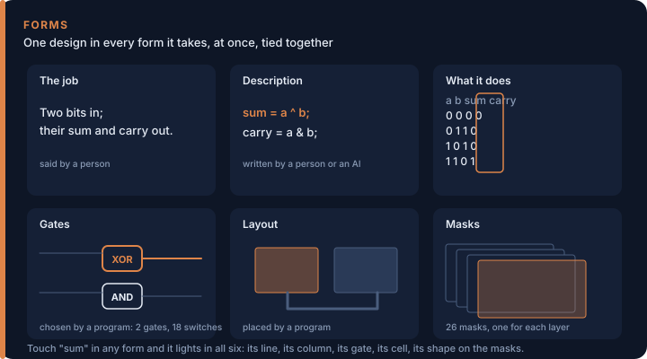

# How could your idea become a chip?

> **The question behind it:** how do ideas become real, and who gets to make them?

## Why it is open

**An idea is free and vague.** "A chip that counts people walking through a door." **A chip is exact and frozen**:
billions of parts, each in one place, unchangeable once made. Every step from the one to the other adds decisions
nobody stated: which gates, where they go, how wide each wire is. Programs and now AI make most of those decisions.
So who designed the chip, and what did they actually decide?

## What is true

**1. A chip begins as a job someone wrote down.** What goes in, what comes out, how fast, at what power and cost. A
chip cannot be changed once made, so a job written badly is built into every copy.

**2. The design is a description of structure, not steps.** Chip designers write in a hardware language, and each
line says what a wire must be at every moment. `sum = a ^ b;` does not run once: it describes gates that always
exist and always answer. A description of a few lines can describe a machine that works billions of times a second.

**3. Checking costs more than describing.** The description must be shown to do the job on every input that matters.
Small circuits can be tried on every input; large ones are checked with chosen tests and with mathematics that
proves properties for every input. Teams often spend more effort checking a design than creating it.

**4. Programs turn the description into gates.** A program (synthesis) chooses which cells of a library to use:
small and slow, or large and fast, trading space, delay and energy. Two descriptions that give the same answers can
become very different circuits: the lab's engine builds a full adder one way with 54 switches and another with 42,
and the smaller is slower.

**5. Programs decide where every cell goes.** Placement puts thousands or billions of cells on the chip so that
wires stay short; routing draws every wire through the layers of metal above. Nobody places them by hand. Each run
can come out differently, and the same gates can need different lengths of wire.

**6. The layout becomes masks.** Each layer of the chip is printed through a mask, a plate that lets light through
in the shape of that layer. An advanced chip needs dozens of masks; a set for the newest processes costs a great
deal, and every mistake found after this point costs a new set.

**7. Then the factory decides the rest.** The same layout made in another factory, or another process, must be
redone below the description: new cells, new placement, new masks (see [make](make.md)). A design is always for a
particular way of making it.

**8. The price of the newest processes keeps rising.** Designing a chip for a 2-nanometre process is estimated at
about $725 million ([CSIS](https://www.csis.org/analysis/billion-dollar-chip-who-can-afford-design-future)),
against about $51 million at 28 nanometres
([SemiEngineering](https://www.semiengineering.com/what-will-that-chip-cost/)). Older processes and shared runs keep
small designs within reach: about $7,000 buys 1,000 finished chips on a shared run
([Tiny Tapeout](https://tinytapeout.com/news/wafer-space-partnership/), a claim).

**9. AI now writes designs.** AI agents write descriptions, tests and reports in seconds, and the big design-tool
companies ship agents of their own ([Futurum](https://futurumgroup.com/insights/synopsys-cadence-and-siemens-take-agentic-chip-design-autonomous-at-dac/)).
The check does not care who wrote the text: it compares answers. The hard part is still saying exactly what the job
is.

## The visual system: Forms

**What it lays out:** one design **in all its forms at once**: the job, the description, what it does (its table of
answers), its gates, its layout, its masks. Not six stations in a row: six views of one thing, side by side, all
alive.

**What you can do:** change the description and watch every form follow at once. Touch a signal, a gate or a wire
in any form and it lights in all of them: its word in the description, its column in the table, its gate, its
cell, its wire on the masks. Under each form, one line says who made that step and what they added that you never
said ("chosen by a program: 5 gates, 42 switches"; "placed by a program: 700 moves tried").

**What it shows that words cannot:** where meaning can slip, between the forms. The questions of this world sit in
those gaps.

**Status:** live on the world's page: the six forms of the half adder, the voter or the full adder, from the Design
flow engine, with a touched signal lit in all of them, and a description you can write yourself. The studio keeps
its stations for the longer jobs.

## The engine: Design flow

**What it computes:** from a description in the lab's small hardware language: its table of answers, checked against
the job; its gates from a cell library; their placement by simulated annealing and their wires; its masks; its
slowest path; how many switches it needs; how many of the faults a factory could leave its tests would catch.

**Its maths:** Boolean algebra and logic minimisation; search (annealing for placement, maze routing for wires);
delay along paths; fault models.

**What it decides:** whether a design does its job; how big, how fast, how testable it is.

**Today:** `src/engines/tinychip.js` and `src/engines/design.js`, tested; it builds for four processes. Missing: a
link from the lab's language to real ones (Verilog), and a way to send a design to a real shared run from the record.

## Questions inside

| Question | Something true to notice |
| --- | --- |
| Who decides what a chip should do, and what happens when the job changes after it is made? | A job written badly is built into every copy. |
| Can a few lines of text describe a machine that runs billions of times a second? | Each line describes a wire, not a step. |
| Change one character of the description. Which form of the design notices? | Every form follows you; only the check against the job can say you are wrong. |
| Two descriptions give the same answers. Are they the same chip? | 42 switches against 54, and the smaller is slower. |
| Nobody placed these cells by hand. Who is the designer? | People describe what the chip should do; programs decide where the parts go. |
| Your tests catch most of the faults a factory could leave. What are the others? | A test checks only what someone thought to check. |
| From a few lines to a set of masks: what did each step add that you never said? | Every step makes decisions; most are made by programs. |
| An AI wrote this in seconds and says it is right. Who checks it, and with what? | The check compares answers; it does not care who wrote the text. |
| Faster, cooler, smaller, cheaper: no chip gets all four. Who chose the trade-offs? | Every chip is a set of compromises made on purpose. |
| Can a chip be built mostly from other people's blocks? | Most phone chips combine licensed designs with parts their makers design themselves. |

## Challenges

| Challenge | What you change | What the engine judges |
| --- | --- | --- |
| **Fix the half adder**, then the majority voter, then the full adder. | the description, by tapping a gate or typing | right on every input |
| **Smaller, or faster?** Two jobs: make the full adder as small as you can, then as fast as you can. | the description | switches; slowest path |
| **Check the agent.** An AI proposes a design and says it is right. Trust it or reject it, and show why. | your verdict, and the input that proves it | your verdict against the truth |
| **Tests that catch.** Choose as few test patterns as you can that catch every fault a factory could leave. | the patterns | the share of faults caught |
| **A piece of the computer.** Design one open piece of the community's computer (a counter, a display driver). | the description | it joins the computer and passes its programs |

The first, the agent check and the pieces of the computer exist today; "smaller or faster" is a try on the lab's
pages.

## Innovation direction: AI as co-designer, and tools anyone can use

- **Agents that design.** AI agents that write descriptions, tests and fixes, and drive the design tools themselves.
  Claims of large speed-ups are early and come from the companies selling them
  ([Unite.AI](https://www.unite.ai/?p=441300), a claim).
- **Open tools.** A complete open flow now takes a description to masks: Yosys turns it into gates, OpenROAD places
  and routes it ([Chartered Semi](https://www.charteredsemi.com/tiny-tapeout-program-explained/)).
- **Shared runs.** Many small designs on one chip, so each pays a share (see [open](open.md)).

**The catch:** the cheaper designing becomes, the more the checking matters, and checking is the part nobody has made
cheap.

## Community topic: designs

Every design in the record says who wrote it (a person, an AI agent, a search program, or a team of them) and how AI
was used. Designs are pieces of the shared computer, or new jobs anyone can propose. Each is checked by the Design
flow engine, can be broken by anyone (see [fail](fail.md)), and can be made smaller or faster by anyone. The record
keeps the smallest and the fastest version of each piece, and who made it.

**How it is judged:** the engine checks the job; the record keeps the authorship.

## Real cases

- **The Pentium division error** (1994): five missing entries in a table inside the divider. The chip did exactly what
  its design said; the design was wrong, and the tests never tried those numbers. Chipmakers turned to proving
  circuits right with mathematics. ([Wikipedia](https://en.wikipedia.org/wiki/Pentium_FDIV_bug))

## Where it meets other questions

- **[think](think.md):** the same description, seen there as a machine that thinks.
- **[make](make.md):** the masks are where the design meets the factory; a design is always for one way of making.
- **[fail](fail.md):** right by its description is not the same as right in the world.
- **[open](open.md):** who can afford to make a design real.

## From earlier work

Fits and comes back: the tiny chip studio (its language, its steps, its masks, its export as Verilog for a real
shared run); checking the AI agent's proposals; layout by simulated annealing; the cost of designing at each
process. Changes: the studio's steps in a row become Forms, all at once.
