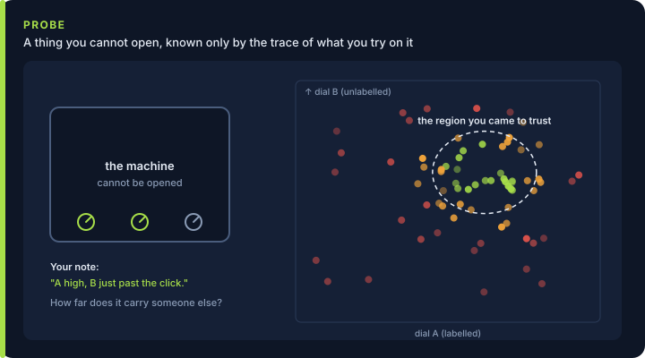

# What part of making chips can't be written down?

> **The question behind it:** how much expertise lives only in people's hands, and can AI ever capture it?

## Why it is open

**Chipmaking is among the most written-down activities there is**: recipes, specifications, papers, millions of
measurements a day. Yet **two teams with the same machines and the same recipes get different chips**, and a new
factory works only when experienced people come to start it. Something is known that is not written. Whether it
could be written, and whether AI trained on everything recorded could learn the rest, is a question about chips and
about knowledge itself.

## What is true

**1. We know more than we can tell.** The philosopher Michael Polanyi put it that way in 1966: a person can recognise
a face without being able to say how. Skill learned by doing (when a machine sounds wrong, when a pattern looks off)
is often impossible to put fully into words.

**2. A recipe is not the whole process.** A recipe says: this gas, this pressure, this temperature, this long. But
each machine differs a little from its twin, drifts as it is used, and changes after it is cleaned. Many settings
act on each other, so the result depends on combinations no recipe lists. The real process is the recipe plus
everything people do to keep it working.

**3. Yield is learned.** When a new process starts, most chips come out broken. Over months, teams find causes one
by one and fix them, and the share of good chips rises. What they learn is partly written down and partly not. A
later factory, a later process, often has to learn again.

**4. Factories are copied exactly, because explaining is not enough.** Chipmakers have long started new factories by
copying a working one as exactly as they can, down to details nobody can prove matter, and by sending people who
ran the old one. A detail can matter without anyone knowing why.

**5. Some knowledge is in the record and nobody reads it.** Factories record millions of measurements. Patterns in
them, a drift in one machine that predicts a failure later, are there to be found. Finding them is what AI is good
at.

**6. Some knowledge was never recorded.** What a team tried and dropped, why a design choice was made, what an
expert noticed and fixed without logging it. AI learns from recorded data. What was never recorded is the hard part.

**7. Designs carry the same problem.** A chip's description is the only full record of what it does; why each line
is there often lives in someone's head. When the designers move on, the chip keeps running and the reasons are gone.

**8. People are scarce.** The US chip industry may be short of up to 157,000 workers by about 2030
([TechRadar, SEMI Foundation](https://techradar.com/pro/we-just-dont-see-that-theres-enough-technical-people-in-the-pipeline-us-chip-fabs-are-facing-a-huge-worker-shortfall-despite-promise-of-huge-paychecks-industry-says-it-still-needs-over-150-000-workers),
an estimate). Machines can be bought; the people who make them work cannot.

## The visual system: Probe

**What it lays out:** **a thing you cannot open**, known only by what you try on it. The machine sits in the middle,
closed. Around it grows the trace of every try: each setting you chose, each result that came back, noisy and
drifting. The picture is the trace: where you looked, what you learned, and the region you came to trust.

**What you can do:** turn the dials and run; see the result, with its noise; build a feel for the machine; write a
note of what you learned; hand the note to someone else, or to an AI, and watch their trace start from it.

**What it shows that words cannot:** what it is like to learn a thing by trying, and how much of it a note carries.
Two traces of the same machine, from a person who read the note and one who did not, side by side.

**Status:** new. This is the world the lab can least fill by itself.

## The engine: Tune

**What it computes:** a machine with dials, some labelled and some not, whose result depends on the settings in ways
that combine, with noise on every run and a slow drift over time; a second machine of the same kind with small
hidden differences. From your tries: how good the best setting you found is, how many tries it took, and how well a
note you wrote helps someone else on the same machine or on its twin.

**Its maths:** finding the best setting through noise; how much is learned from each try; learning curves.

**What it decides:** whether a note carries what was learned; whether a search program does better or worse than a
person; how much a second machine has to be learned again.

**Today:** missing. It must not be written as a fake factory: it is a model of learning a process, and its design
should be read by someone who has worked in one before it is built. Its words must say plainly what it is not.

## Questions inside

| Question | Something true to notice |
| --- | --- |
| Two teams with the same tools get different chips. What does one know that the other does not? | Skill learned by doing is often impossible to put fully into words. |
| Getting this shape right took decades of trial and error. Can an AI learn what was never written down? | AI learns from recorded data. What was never recorded is the hard part. |
| Robots carry the wafers, yet the factory depends on people who can tell a machine is not quite right. Can that be written down? | Starting a new factory often means bringing in people from an old one. |
| Pulling a crystal this pure is slow and delicate. How much depends on people who have done it for years? | Only a few companies in the world make most of the wafers chips are built on. |
| A phone photo is shaped by people who said "that looks right". Can taste be written down? | A camera's colours are tuned by eye. |
| Who will read this description in ten years, when its designers have moved on? | Why each line is there often lives only in someone's head. |
| A second factory, the same machines, worse chips. Copy everything, or learn again? | Factories are copied down to details nobody can prove matter. |
| Small, cheap chips ran out and car factories stopped. How can a part that costs so little stop so much? | Many car chips are made in factories qualified years ago, which cannot simply be swapped. |

## Challenges

| Challenge | What you change | What the engine judges |
| --- | --- | --- |
| **Nine dials.** Some unlabelled. Get the process right without being told how. | the dials | the best result, and the tries it took |
| **The note.** Write down what you learned. Someone else starts from your note alone. | your note | how far your note gets them, against starting cold |
| **The twin.** The same machine in a second factory gives worse results. Copy your settings, or learn again? | your strategy | the result, and the tries |
| **You or the program.** A search program turns the same dials. Who gets there in fewer tries, and what does each know at the end? | nothing: you compare | tries and result for each; whether the program's answer carries to the twin |
| **Why each line.** Write the reasons into a design so that someone who never met you can change it safely. | the notes in a description | the change someone else makes is right the first time |

All need the Tune engine except "why each line", which needs only the Design flow engine and a second person.

## Innovation direction: AI that learns the craft

- **Learning from the machines.** Factories feed their sensor data to AI that predicts a failing tool, a drifting
  layer or a bad wafer before a person sees it; TSMC is reported to be adopting such systems for printing, inspection
  and digital copies of its factories ([Let's Data Science](https://letsdatascience.com/news/tsmc-adopts-nvidia-accelerated-computing-for-fab-automation-29d5ad01),
  a claim).
- **Searching instead of guessing.** Programs that choose the next experiment so that each one teaches the most,
  finding good recipes in fewer tries.
- **Recording the unrecorded.** Capturing what experts do and say while they work, so the next generation, or an AI,
  has it to learn from.

**The catch:** a model trained on a factory's records knows that factory. What made the records (the people, the
choices nobody logged) is still not in them.

## Community topic: handover

The lab cannot fill this world alone. It needs people who have made chips: their stories, signed or sourced; what
they wish they had been told; what no document they ever read said. And it needs the experiment that tests it:
notes handed from one visitor to the next, from people to AI agents and back, and a record of how far each note
carried.

**How it is judged:** the Tune engine measures how far a note carries; a story is kept with its author's name or its
source.

## Real cases

- **A process that would not come** (2016 to 2019): Intel planned its 10-nanometre process for 2016; it reached
  volume only in August 2019 ([PCWorld](https://www.pcworld.com/article/399328/amd-ryzen-5000-arm-macs-intel-10nm-struggles.html)).
  The plans were written; making them work took three more years.
- **The car-chip shortage** (2021): about 7.7 million vehicles not built
  ([CNBC, AlixPartners](https://www.cnbc.com/2021/09/23/chip-shortage-expected-to-cost-auto-industry-210-billion-in-2021.html),
  an estimate), partly because a car chip qualified in one factory cannot simply be made in another.

## Where it meets other questions

- **[make](make.md):** recipes are the written part of making; this world is the rest.
- **[open](open.md):** open designs and open tools spread what can be written; this is what does not spread with them.
- **[idea](idea.md):** AI agents learn from designs written down; the reasons behind them are often missing.

## From earlier work

Little exists, which is itself the finding: the first versions of the lab covered what is written about chips. The
dive's questions about taste, crystal pulling and the factory's people come back; the workforce figure comes back.
