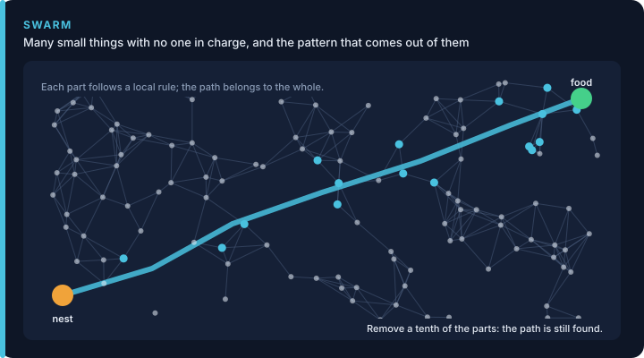

# What new kinds of computers could brains, swarms and living cells inspire?

> **The question behind it:** if we stopped copying the eighty-year-old design of the computer, what would we copy
> instead?

## Why it is open

Almost every computer follows one design from the 1940s: **one clock, one program, one designer**, memory kept apart
from the arithmetic. Nature computes with **no centre at all**: many small units, local rules, and a pattern nobody
wrote. A brain runs on about 20 watts ([The Physics Factbook](https://hypertextbook.com/facts/2001/JacquelineLing.shtml));
an ant colony finds the shortest path to food with no ant knowing the map. We know these systems work. We do not know
how to build chips like them that are as useful as the chips we have, or which of their ideas matter.

## What is true

**1. A neuron works only when news arrives.** A brain cell collects small pulses from others, slowly leaks what it
collected, and sends a pulse of its own only when it crosses a threshold. Most neurons are quiet most of the time,
which is why a brain spends so little. A chip, by contrast, marches to a clock: designers stop it wherever a part is
idle, yet the clock that is left still takes a large share of the chip's power.

**2. In a brain, memory and computing are the same place.** The junctions between neurons (synapses) hold what has
been learned, and they are where the computing happens. Nothing is fetched. A chip spends most of its energy moving
numbers between memory and arithmetic (see [divide](divide.md)).

**3. Learning is local.** A synapse strengthens or weakens by what happens on its two sides, without a central teacher
reading every connection. Today's AI learns by sending corrections back through every layer of a model, which needs
the whole model in one place.

**4. Many simple parts can be robust.** Kill a tenth of a brain's neurons, or of a colony's ants, and the whole goes
on, a little worse. Kill one wire in a chip and it may give wrong answers forever. Robustness from numbers, not from
perfect parts.

**5. Patterns come from local rules.** Ants leave scent where they walk, and follow scent where they find it; the
shortest path collects the most scent, and the colony finds it. Nobody computed it. Many problems (routes, schedules,
searches) can be solved by swarms of simple agents following local rules.

**6. Eyes compute before they send.** An eye does not send every point of light to the brain: much of the work
happens before the signal leaves it, and mostly it reports what changes. A camera sends every pixel, every frame.

**7. Life builds itself.** A cell assembles complex molecular machines at room temperature, without a clean room, by
following instructions in its DNA. A chip factory needs vacuum, plasma and billions of dollars.

**8. The comparison is unfair in both directions.** A brain is poor at arithmetic and cannot be copied or reset; a
chip is exact, fast and identical in every copy. The question is not which is better but which ideas could cross.

## The visual system: Swarm

**What it lays out:** **many small things with no one in charge, and the pattern that comes out of them**: units
drawn as points, each with its local rule; pulses, trails or signals passing between neighbours; and, rising from
them, the behaviour of the whole: a path found, a pattern recognised, a task shared out. Side by side, the same task
done by a clocked chip, for comparison of energy and robustness.

**What you can do:** change the local rule; kill a share of the units; make the input quiet or busy; watch the energy
fall when nothing happens and the pattern survive damage, or not.

**What it shows that words cannot:** that behaviour can belong to the whole and to no part, and what that costs and
gains.

**Status:** live on the world's page: a colony of ants on a short and a long bridge, each ant following the rule
measured on Argentine ants, with the rule, the colony, the shortcut and the damage to change; and two eyes side by
side, a camera that reads every pixel and eye-like pixels that report only what changed. Still to come: spiking
neurons, and the clocked chip doing the same task beside the swarm.

## The engine: Swarm

**What it computes:** many simple units with local rules: spiking neurons that collect, leak and fire; agents that
leave and follow trails; cells that pass signals. From them: what the whole computes, at what energy (counting events,
not ticks), and how much damage it survives.

**Its maths:** systems of many interacting parts; events instead of steps; local learning rules.

**What it decides:** whether a swarm solves a task; how much energy it spends against a clocked chip; how it degrades
when parts are removed.

**Today:** exists in part (`src/engines/swarm.js`): trails, with the choice rule fitted by Deneubourg and colleagues
(1990) and the late shortcut of Goss and colleagues (1989); and eyes, counting a camera's reads against an event
camera's reports. Missing: spiking neurons that collect, leak and fire (the first version of the lab had a pair to
tune), and local learning. One more live specimen: the lab itself, whose ledger works out what is open and pulls
work toward it (`src/engines/ledger.js`, the frontier).

## Questions inside

| Question | Something true to notice |
| --- | --- |
| A hall can use as much power as a town; a brain about 20 watts. What is the brain doing differently? | Most of its neurons are quiet most of the time. |
| What if each part of a chip worked only when news arrived? | The clock left running still takes a large share of a chip's power. |
| A synapse stores and computes in the same place. What would a switch like that be? | In a brain, the connections that hold memories are the ones that compute. |
| Your brain runs on the power of a dim bulb; your phone needs charging nightly. What would a chip that sips look like? | Most of the time a phone's chip is waiting; what it spends while waiting decides the battery. |
| Animals see with far less energy than a camera. What could chips learn from eyes? | An eye reports mostly what changes. |
| Kill a tenth of the parts. Which machine still answers? | A brain does; a chip with one dead wire may not. |
| Life builds with atoms cheaply, at room temperature. What could chemistry teach a factory? | A cell assembles molecular machines without a clean room. |
| Nobody is in charge of this lab. What pulls work to where it is needed? | Open things that call loudest get worked on first. |

## Challenges

| Challenge | What you change | What the engine judges |
| --- | --- | --- |
| **Tune a neuron.** Make one spiking neuron answer pattern A and stay quiet for B and for noise. | its threshold, its leak | right answers; events spent |
| **Quiet costs nothing.** The same detector, clocked and spiking, on a scene where little happens. | the scene | energy of each |
| **Survive the damage.** Remove units one by one. How many before the swarm fails, and the chip? | how many are removed | the task still done |
| **Change the rule.** Change how this lab decides which open thing calls loudest. Does work spread better? | the rule | how the record's work would have spread under it |

"Quiet costs nothing" and "Survive the damage" are played on the page (the eyes, and a third of the ants taken
away); "Tune a neuron" came from the first version of the lab and needs spiking neurons in the engine; "change the
rule" can be run on the lab's record today.

## Innovation direction: neuromorphic, event-driven and living computers

- **Neuromorphic chips** that spike only when something changes. Intel's Hala Point joins 1,152 such chips, with
  1.15 billion neurons, at up to 2,600 watts ([Intel](https://newsroom.intel.com/artificial-intelligence/intel-builds-worlds-largest-neuromorphic-system-to));
  IBM's NorthPole puts memory beside every core ([Singularity Hub](https://singularityhub.com/2023/10/24/this-brain-like-ibm-chip-could-drastically-cut-the-cost-of-ai/),
  a claim).
- **Cameras that report change**, like an eye, and chips that compute where the image is captured.
- **Parts that remember** the current that has passed through them, as synapses do.
- **Living computers**: neurons grown on a chip, learning from feedback; one is on sale for about $35,000
  ([Live Science](https://livescience.com/technology/computing/worlds-1st-computer-that-combines-human-brain-with-silicon-now-available)).

**The catch:** most software is written for clocked chips; training spiking networks is still hard; and a brain's
efficiency comes from billions of years of design nobody fully understands.

## Community topic: the lab as a swarm

The lab is organized like the systems this world studies: nobody assigns work. People and AI agents leave traces
(designs, breaks, tries, questions) in a shared record, and the record works out what is open and how loudly it
calls, the way scent calls ants. Who does what is read from what they did, not given. The community's question here
is about itself: which local rules make the lab find and finish its work best? Anyone may propose a rule and replay
the record under it.

**How it is judged:** a rule is replayed on the real record; it wins when work would have spread better under it.

## Real cases

- **The largest neuromorphic system** (2024): Intel Hala Point, 1.15 billion neurons
  ([Intel](https://newsroom.intel.com/artificial-intelligence/intel-builds-worlds-largest-neuromorphic-system-to)).
- **Neuromorphic machines in 2026**: SpiNNaker2 at Sandia, about 175 million neurons, and others
  ([Supercomputing News](https://www.supercomputing.news/emerging/neuromorphic-computing-2026-spinnaker2-intel-edge-robotics)).

## Where it meets other questions

- **[divide](divide.md):** a brain does not separate memory from computing.
- **[strange](strange.md):** neurons and cells as media on the strange shelf.
- **[open](open.md):** the community organizing itself is this world's live specimen.
- **[fail](fail.md):** robustness from many imperfect parts, against reliability from perfect ones.

## From earlier work

Fits and comes back: neuromorphic chips (tune a spiking neuron); compute in memory; the dive's questions about the
brain's 20 watts, the eye and the synapse; the community's frontier, which works like scent.
