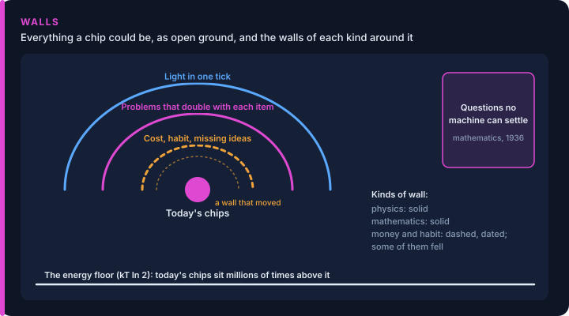

# What could a chip never do, and could it learn to?

> **The question behind it:** can a creation go beyond its creator?

## Why it is open

**Some walls are laws** of nature or of mathematics: no engineering will move them. **Many walls were only money,
habit or a lack of ideas**, and fell, often after experts had called them final. Every limit a chip meets is one of
these kinds, and it is rarely obvious which. Telling them apart is most of the question; the rest is whether a chip
that keeps changing after it is made could get past walls its designers put there.

## What is true

**1. Some questions no machine can settle.** In 1936, before any chip existed, Alan Turing proved that no program
can look at every other program and say whether it will ever stop
([Wikipedia: Turing's proof](https://en.wikipedia.org/wiki/Turing%27s_proof)). This is not about speed. A machine a
billion times faster is no closer. It is a wall of mathematics, and it holds for every computer that can be built
from logic, silicon or otherwise.

**2. Some problems grow faster than any chip.** For many problems (the best route through many cities, the best way
to pack boxes) the only known methods take about twice as long for every item added. A chip twice as fast buys one
more item; a chip a thousand times faster buys about ten. Whether there are always cleverer methods is one of the
great unsolved questions of mathematics. Nobody has proved that "too hard" is a law.

**3. Erasing a bit has a price.** Rolf Landauer showed in 1961 that throwing away one bit of information releases at
least a small amount of heat, set only by temperature: kT ln 2, about 3 zeptojoules at room temperature (3 × 10⁻²¹
joules). It was measured in 2012 ([Nature](https://www.nature.com/articles/nature10872)). Ordinary logic throws
bits away all the time (a gate takes two bits and gives one), so this is a floor under every computation done the
usual way.

**4. Today's chips are far above that floor.** One multiply-and-add on a chip spends many millions of times the
floor, and most of it goes to moving the numbers, not to the arithmetic (the Floor engine works this out for your
chip). Physics leaves a great deal of room. What stands in the way is engineering.

**5. Cold does not help.** A colder chip has a lower floor, but its heat must be pumped out to a warm room, and even
a perfect refrigerator pays exactly the difference (the Carnot limit). Cooling can make real switches waste less;
it cannot lower the floor.

**6. Nothing outruns light.** In the glass between a chip's wires, light travels about half as fast as in empty
space: some 7 or 8 centimetres in one tick of a 2-gigahertz clock. Real wires are many times slower. A signal can
only cross so much chip in one tick, which is part of why big chips are divided (see [divide](divide.md)).

**7. Being sure by trying grows impossibly fast.** To check an adder of 64 bits by trying every pair of inputs, you
would try 2¹²⁸ pairs: at a trillion a second, about 10¹⁹ years. Big circuits are proved right with logic, or tested
in pieces small enough to try whole.

**8. A chip is frozen the day it is made.** Its wiring cannot change. Some chips can be rewired after they are made
(programmable logic), and some keep learning while they run; most cannot. A frozen chip can still run new programs:
software is how a fixed machine does things its makers never imagined.

## The visual system: Walls

**What it lays out:** everything a chip could be, as open ground with walls around it. Where today's chips stand is
a settlement; out from it run directions (less energy per step, more speed, more certainty, more problems
solvable). Each wall is drawn by its kind: physics (the energy floor, the speed of light), mathematics (questions
no machine can settle, problems that double), and the soft walls (cost, habit, missing ideas). Soft walls carry
dates; some have moved, and you can watch them move.

**What you can do:** walk toward a wall and see what stops you, in the engine's numbers: how far your chip is from
the energy floor, how many more items a faster chip buys, how long trying every case would take. Move through time
and see which walls fell.

**What it shows that words cannot:** that walls are of different kinds, at very different distances. The hard
ones are mostly far away; the ones that stop us now are mostly soft.

**Status:** new. Three tries from the Floor engine are on the lab's pages today (the floor, the cold, trying every
case).

## The engine: Floor

**What it computes:** the least energy a step can take at a temperature, and your chip's energy for one
multiply-and-add against it; what cooling costs; how far light goes in one tick of your clock; how long trying
every input of a circuit takes.

**Its maths:** thermodynamics (Landauer's limit, the Carnot limit); the speed of light in a material; counting.

**What it decides:** how far a chip is from each physical wall; whether a claimed saving breaks a law.

**Today:** `src/engines/floor.js` (the energy floor, the cold, light's reach, counting), tested. Missing: the growth
of problems that double, and a picture for questions no machine can settle.

## Questions inside

| Question | Something true to notice |
| --- | --- |
| A rack like this can write, draw and compose. Is there anything it could never do? | Some questions were proved unsettleable in 1936, before any chip existed. |
| For some problems the work doubles with every item. Law of nature, or lack of ideas? | For those problems a chip twice as fast buys one more item. |
| Physics sets a smallest energy for erasing a bit. Is there a floor under all thinking? | Each switch flip in today's chips uses many thousands of times that minimum. |
| Cool the chip and the floor drops. Why does that save nothing? | Pumping the heat out costs exactly the difference, even with a perfect refrigerator. |
| To be sure of a 64-bit adder by trying, how long would it take? | Longer than the universe has existed, at any speed. |
| A blind search found a circuit that works and nobody can explain. Would you ship it? | Evolved circuits are sometimes smaller than a person's, and always stranger. |
| A chip is frozen the day it is made. What if it kept changing? | A few kinds of chip can be rewired after they are made. |
| Will this program ever stop? | For one famous three-line rule (halve if even, else triple and add one), nobody knows if it stops for every start. |

## Challenges

| Challenge | What you change | What the engine judges |
| --- | --- | --- |
| **Close to the floor.** Bring your chip's multiply-and-add as near the floor as you can. | switch size, how often each number is used, where memory sits | times above the floor |
| **Cold that pays.** Find a temperature and a refrigerator that save energy overall. | temperature, refrigerator efficiency | it never pays: the engine shows why |
| **One more item.** A problem doubles with each item. How many more items does a thousand times faster buy? | your guess, then the chip | the count |
| **Will it stop?** Pick starting numbers for the three-line rule and find the one that takes longest to reach 1. | the start | the number of steps |
| **Explain the evolved one.** A circuit found by blind search: say what each gate is for. | your explanation, as a description | the engine checks your description gives the same answers |

The first two exist as tries today; "will it stop" needs only a small engine; the evolved circuit came from the
first version of the lab.

## Innovation direction: get past the floor, or around the freeze

- **Reversible computing.** Logic that throws no information away does not pay Landauer's price, and a switch's
  energy can be recycled instead of turned to heat. A 22-nanometre test chip has recovered energy this way
  ([EE Times](https://www.eetimes.com/vaire-demos-energy-recovery-with-reversible-computing-test-chip/)). The catch:
  slower, more transistors, and no whole computer built this way yet.
- **Approximate computing.** Spend less where small errors do not matter: learned models run well on numbers of 8
  or 4 bits. The catch: someone must check the errors are harmless.
- **Chips that change.** Programmable logic rewired in the field; chips that learn while they run. The catch: what
  is checked before shipping is no longer what runs later.

## Community topic: walls that fell

A table of walls: each claim that something was impossible, who made it and when, its kind (physics, mathematics,
money, habit), how close anyone has come, and, for those that fell, what moved them. One familiar case to start:
light was long thought unable to print details smaller than its own wavelength; 193-nanometre light went on to
print features several times smaller, with water under the lens and patterns split over several exposures.

**How it is judged:** each entry needs a dated source for the claim and one for what moved it. Physics walls are
checked by the Floor engine: a claimed device under the floor is a mistake, not a wall falling.

## Real cases

- **Landauer's limit, measured** (2012): erasing a single bit, held by a small bead in a laser trap, released heat
  close to kT ln 2. ([Nature](https://www.nature.com/articles/nature10872))
- **Turing's proof** (1936): the first wall of mathematics, older than every chip.
  ([Wikipedia](https://en.wikipedia.org/wiki/Turing%27s_proof))

## Where it meets other questions

- **[strange](strange.md):** every medium that erases bits meets the same floor; reversible logic is the one bet
  that does not.
- **[fail](fail.md):** trying every case is impossible for big circuits, so some faults are never tried.
- **[scale](scale.md):** many walls in a forecast are soft walls; the forecasts record which ones fell.
- **[think](think.md):** a frozen chip that runs any program is how a fixed machine goes beyond its designers.

## From earlier work

Fits and comes back: the physics floor (a multiply-add, an AI word, a photo against the floor; cold is not free;
light in one tick); reversible computing; evolving a circuit and asking whether you would ship it. The questions of
the dive about what a rack could never do.
