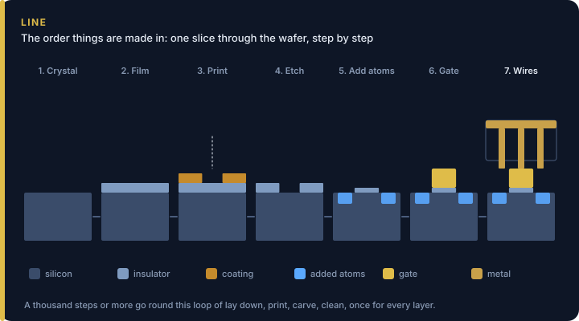

# What would chipmaking look like if we invented it from scratch today?

> **The question behind it:** how much of our technology is the way it is only because of history?

## Why it is open

**Today's way is astonishingly good**: billions of switches, each a few dozen atoms across, made at once and nearly
all of them working. But **it is one path among many**, chosen step by step over sixty years and now held in place by
factories that cost tens of billions. If we started today, knowing what we know, would we still print with light,
carve layers away, and build factories around keeping dust out? Asking what is necessary and what is history is how
to see the whole process clearly.

## What is true

**1. A switch is made of a few materials in the right shape.** A transistor needs a channel of silicon whose
conduction can be controlled, a gate of conductor above it, and an insulating skin between them a few atoms thick.
Making a chip means making that shape billions of times, then wiring the switches together.

**2. It starts as a perfect crystal.** Sand is purified into silicon, melted, and pulled up as one single crystal: a
rod in which every atom sits in the same pattern. A row of atoms out of place spoils every chip cut from that part.
The rod is sliced into round wafers, which is why chips are made on round discs and the ones at the edge are lost.

**3. Atoms are added on purpose.** Pure silicon conducts poorly. Firing a few atoms of another element into it, by
the trillion, changes how easily current flows there. Those impurities are what make a switch possible; a flash of
heat afterwards lets the crystal settle back into its pattern.

**4. Everything else is made by one loop, repeated.** Lay down a thin film of some material; cover it with a
light-sensitive coating; print a pattern into the coating with light through a mask; carve away what the pattern
leaves open; clean; check; repeat. Switches are built at the bottom, then a dozen or more layers of wiring above
them. An advanced chip takes a thousand steps or more
([Semiconductor Engineering](https://semiengineering.com/why-fabs-worry-about-tool-parts)) and several months: about
40 days for a 28-nanometre chip and 80 to 85 for a 7-nanometre one
([ECIA](https://ecianow.org/assets/docs/Stats/LeadTimes/Understanding%20Lead%20Times.pdf), an estimate).

**5. Printing with light is fast because it is parallel.** A mask prints a whole chip in one flash, every switch at
once. That is why masks won over drawing patterns one point at a time with a beam: a beam can draw finer, but far
too slowly for millions of chips. Printing smaller needs shorter light: the newest machines use light of 13.5
nanometres ([ASML](https://www.asml.com/products/euv-lithography-systems)), made by hitting drops of molten tin with
a laser, in a vacuum, because air swallows it.

**6. Most of what is laid down is carved away.** The shapes are made by covering the whole wafer and removing what is
not wanted. Plasma etching can cut trenches much deeper than they are wide, straight down, because charged particles
are pulled down by an electric field.

**7. Every step multiplies.** If each of a thousand steps succeeded 99 times in 100, almost nothing would come out.
So every step must succeed nearly every time, on nearly every one of billions of features. This is why factories
are built around cleanliness: a speck far smaller than a hair can ruin a chip.

**8. The factory is a queue.** Hundreds of machines each do one kind of step, and a wafer visits some of them many
times, once for each layer. The scarcest machine sets the pace; a factory run near full makes cheaper wafers that
wait longer. A leading factory module costs about $25–35 billion
([Tom's Hardware](https://www.tomshardware.com/tech-industry/tsmc-commits-another-100-billion-to-arizona-for-at-least-four-more-2nm-fabs),
an estimate), so it must run full for years to pay.

**9. The package is now part of the chip.** The finished chip is cut out, flipped face down onto tiny solder bumps,
and sealed in a package that joins it to the world. Packages now join several chips and stacks of memory close
enough to act almost as one.

## The visual system: Line

**What it lays out:** the order things are made in. **One slice through the wafer, followed through every step**:
the crystal, then the films, the prints, the cuts, the added atoms, the wires, layer by layer, the slice growing
in front of you. Above it, the machine at work for that step, and the factory's queue it waited in.

**What you can do:** move along the line, step by step or freely; stop at a step and look at the slice; open the
machine; see what the step does to your own design's shapes. Planned: change the recipe (swap two steps, use
another way to print, add atoms before or after the gate is made) and see whether a working switch still comes out.

**What it shows that words cannot:** that a chip is built up and carved down in hundreds of thin steps, and that the
order matters.

**Status:** exists: the line in 3D, the factory you run, and the dive inside a machine. The recipe you can change is
new.

## The engine: Process

**What it computes:** a recipe of steps (lay down, print, carve, add atoms, heat, polish) acting on a slice through
the wafer, as a grid of materials; and a check of what came out: is there a channel, a gate over it, an insulating
skin between, contacts that reach? Then how long the recipe takes in a factory and how much of it survives.

**Its maths:** geometry on a grid of cells (adding, masking and removing layers); a queue for the factory (how long a
wafer waits at each machine); a product of chances for what survives.

**What it decides:** whether a recipe makes a working switch; how long and how costly it is; what a change of order
or method does.

**Today:** the factory as a queue exists (`src/engines/fab.js`: months in the factory, the machine that sets the
pace); the slice is drawn step by step but nothing judges a recipe. The Process engine itself is missing; it is
the one contribution that would turn this world from something you watch into something you invent.

## Questions inside

| Question | Something true to notice |
| --- | --- |
| Chips are printed with light onto flat round wafers. Was that the only way it could have gone? | The newest machines print with light of 13.5 nanometres. |
| Why must the whole crystal be one unbroken pattern? | A row of atoms out of place spoils every chip cut from that part. |
| Hundreds of square chips on a round disc. Why round? | The crystal grows as a round rod; chips at the edge are wasted. |
| Why would you want impurities? | A few added atoms change how easily current flows: that is what makes a switch. |
| This shape is made by adding layers and carving most of them away. Could it grow by itself? | A thousand steps or more, and every switch is made at the same time. |
| How do you cut only downward? | Charged particles are pulled straight down by an electric field. |
| Why not draw the chip directly onto each wafer? | A beam can draw it, but far too slowly; a mask prints a whole chip at once. |
| Must a chip be made one layer at a time? | Each lap of the loop makes one layer; a chip needs dozens. |
| This whole factory exists to keep dust away. Would we still build it this way? | The air is kept far cleaner than an operating theatre's. |
| Why face down? | Face down, every part of the chip can connect straight to the package. |
| What if atoms could be placed one at a time? | It has been done in the laboratory, slowly, with the tip of a microscope. |

## Challenges

| Challenge | What you change | What the engine judges |
| --- | --- | --- |
| **Through in time.** Get your wafers through the factory in under 60 days while it runs nearly full. | the factory's load, its machines | days in the factory; how full it runs |
| **Fewer layers.** Make a chip that needs fewer layers and still has its cores. | the process, the design | layers; cores |
| **The order of steps.** Add the atoms before the gate is made, or after. Which order lines itself up? | the recipe | whether a working switch comes out |
| **Without a mask.** Draw every chip with a beam. What happens to the hours, and to the cost? | the printing method | time and cost per wafer |
| **A factory in a room.** Make chips in small batches in one room. What does it give up? | the factory's size and method | cost per chip at each volume |

The first two exist today; the others need the Process engine.

## Innovation direction: make it another way

- **Printing without masks:** beams that draw patterns directly, slowly but with no mask to buy; stamping patterns
  like a seal.
- **Small factories:** rooms that make chips in small batches, keeping only each wafer's sealed box clean instead of
  the whole building.
- **Building up instead of carving:** films laid down one layer of atoms at a time (already used in factories);
  materials that arrange themselves; single atoms placed with a microscope tip, for quantum chips.
- **Stacking:** switches on top of switches, and chips stacked on chips, instead of one flat layer (see
  [scale](scale.md)).

**The catch:** today's method is the result of trillions of dollars of learning. A new method must be better not
only than today's best, but than everything that has already been paid for.

## Community topic: recipes

A recipe is a way to make the same switch: a list of steps, their order, their methods. The community collects
recipes that do a step or the whole line another way, judged by whether a working switch still comes out, and at
what time and cost. Historical recipes belong too (how chips were made in 1971, in 1990), so the line can be seen
as one path among many.

**How it is judged:** the Process engine makes the slice and checks the switch; the factory engine gives the time.

## Real cases

- **Building a factory** now takes about two years at best: TSMC aims for that per Arizona factory
  ([New Electronics](https://www.newelectronics.co.uk/content/news/tsmc-looks-to-compress-arizona-fab-construction-into-just-two-years)).
- **High-NA**, the newest printing machine, about $400 million each
  ([Igor's Lab](https://www.igorslab.de/en/intel-high-na-euv-volume-production-panther-lake-400-million-dollar-pilot-run/),
  an estimate), went into volume production on some layers in 2026
  ([ASML](https://www.asml.com/news/press-releases/2026/high-na-euv-reaches-new-readiness-milestone)).

## Where it meets other questions

- **[idea](idea.md):** the masks are where a design meets the factory.
- **[fail](fail.md):** every step leaves its mark on how copies differ; specks are the factory's problem as much as
  the design's.
- **[know](know.md):** recipes are written down; getting them to work is not all written down.
- **[scale](scale.md):** each smaller switch has needed new steps, more masks and costlier machines.

## From earlier work

Fits and comes back: the line from crystal to shipped chip in 3D; the factory you run (why chips take months, the
machine that sets the pace); inside the fab (the patterning loop, the cleanroom, overlay, inspection); lithography
(resolution, EUV, the photon budget); from sand to switch (doping, the crystal).
