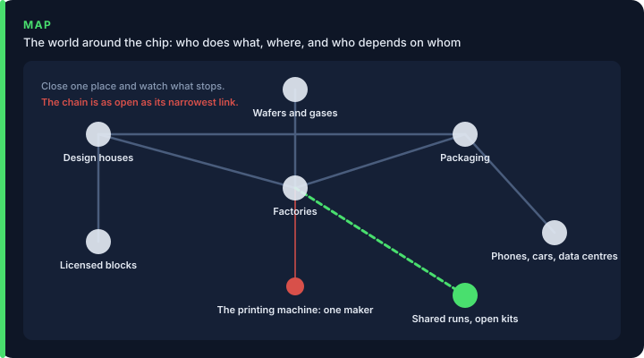

# What happens when anyone can make a chip?

> **The question behind it:** what happens to a society when powerful tools reach everyone?

## Why it is open

**A few** companies can make the newest chips, and a single company makes the machine that prints them. **Anyone**
can now put a small design on a shared chip, and a run of a thousand finished chips costs about as much as a
used car. Both are true at once. Software went
from a few companies to everyone, and the world changed. Chips may or may not follow, because hardware is
different: every attempt costs masks, factory time and testing. What opens, what stays closed, and what it would
mean if making chips became as open as writing software, is the question.

## What is true

**1. The industry is divided into specialists.** A chip is designed by one company, often with blocks licensed from
others; made by a factory that makes chips for many companies, rivals included; packaged and tested by another;
and built from wafers, gases and machines from a few suppliers each. Most chip companies never make a chip
themselves.

**2. Some links have one supplier.** Every machine that prints the newest chips comes from a single maker; it took
decades and parts from many countries to make it work. The most advanced chips pass through a few factories and a
few packaging lines. A chain is as open as its narrowest link.

**3. When one link stops, everything after it waits.** In 2021, cheap chips for cars ran out and car factories
stopped: about 7.7 million vehicles were not built
([CNBC, AlixPartners](https://www.cnbc.com/2021/09/23/chip-shortage-expected-to-cost-auto-industry-210-billion-in-2021.html),
an estimate). A part that costs little can stop a great deal.

**4. The cost of making is mostly fixed.** Masks, factory time and the design itself cost the same whether you make
ten chips or ten million. That is what keeps one person from making a chip of their own, and what sharing changes:
split one set of masks and wafers among many designs, and each pays a share.

**5. Shared runs make it real.** Projects like Tiny Tapeout put hundreds of small designs on one chip. About $7,000
buys 1,000 finished chips on a shared run of an older process
([Tiny Tapeout](https://tinytapeout.com/news/wafer-space-partnership/), a claim); one tile holds about a thousand
cells. Small, slow, cheap and real.

**6. Open parts exist at every level.** RISC-V is an open instruction set: anyone may build a processor for it without
asking or paying, and full operating systems now target it
([Canonical](https://canonical.com/blog/canonical-and-ubuntu-risc-v-a-2025-retro-and-looking-forward-to-2026)). A
32-bit RISC-V chip sells for less than ten cents
([Hackster.io](https://www.hackster.io/news/wch-launches-a-sub-10-risc-v-microcontroller-while-a-6-90-dev-board-gets-you-started-90b1ffd7490a)).
A few factories publish the rules for drawing a chip for their process (open design kits), and open tools take a
description all the way to masks
([Chartered Semi](https://www.charteredsemi.com/tiny-tapeout-program-explained/)).

**7. Open is not the same as easy.** An open description can be reused by anyone; its layout fits only one factory's
process. A public standard is not a working product: the rules every phone's radio follows are public, and only a
few companies make modems. Most of what it takes to make a chip is still knowledge (see [know](know.md)).

**8. Open cuts both ways.** An open design can be checked by anyone, and copied by anyone. For most chips the drawings
are secret: only the maker and its factory can check them.

## The visual system: Map

**What it lays out:** the world around the chip: **who does what, where, and who depends on whom**. Places (design
houses, factories, packaging lines, the makers of machines, materials and wafers) and the routes a chip takes
between them, across countries; and beside it, the map of the open world: shared runs, open kits, open cores, the
community's own designs.

**What you can do:** follow one chip's trip; close a place and watch what stops, what slows and what waits; open a
shared run and see where a design from anyone joins the trip.

**What it shows that words cannot:** where the chain is narrow, and where it is wide open.

**Status:** exists: the supply map, where closing a place shows what stops. The open world drawn on the same map is
new.

## The engine: Supply and cost

**What it computes:** a chip's trip as steps, each done in some places, needing some things from others: which steps
stop, strain or wait when places close. And the cost of making: the fixed part (masks, design, factory time) and
the part per chip, and how they split when many designs share a run.

**Its maths:** dependence along a chain; fixed against per-unit cost; shares.

**What it decides:** what stops when a place closes; what a design costs alone and in a shared run.

**Today:** the chain exists (`src/engines/supply.js`, `src/data/world.js`), tested. The cost of making, and how it
splits on a shared run, is missing as an engine of its own.

## Questions inside

| Question | Something true to notice |
| --- | --- |
| Could anyone design a chip? What would they need, apart from an idea? | Open tools and shared chips make a first design possible for one person; most of what it takes is still knowledge. |
| One person could never pay for a chip of their own. What changes when many share one? | Shared runs split the masks and the wafers between everyone on them. |
| An open block can be reused as a description, but its layout fits one factory. What would let open parts spread the way software did? | Software grew by people building on each other's pieces. |
| An open design can be checked by anyone, and copied by anyone. Strength or risk? | Most chip drawings are secret: only the maker and its factory can check them. |
| Every machine like this comes from a single maker. What does that mean for everyone else? | It took decades and parts from many countries to make it work. |
| The same factory makes chips for rival companies. What does it owe them? | Many chip companies design chips but never make them. |
| The radio rules every phone follows are public, yet few companies make modems. Why? | Writing a standard down is not building something that works with every network. |
| A RISC-V chip now costs less than ten cents. What becomes possible? | An open instruction set costs nothing to use. |
| Many strangers can share one chip. What should they build together? | Shared runs have put hundreds of small designs on one chip. |

## Challenges

| Challenge | What you change | What the engine judges |
| --- | --- | --- |
| **Close one place.** Which single place stops the most chips? | which place closes | what stops, strains and waits |
| **Make the chain wider.** With a budget, open a second source for steps. Where does it help most? | where you add a source | what still stops when places close |
| **Your share.** Your design fits one tile. What does it cost alone, and on a shared run? | the run, the number of designs on it | your share |
| **Move it.** Take an open design to another factory's process. What has to be done again? | the process | what changes below the description |

The first exists today; the others need the cost engine.

## Innovation direction: open hardware

- **Open instruction sets:** RISC-V, used from ten-cent controllers to full computers.
- **Open design kits and tools:** factories publishing their drawing rules; Yosys, OpenROAD and others taking a
  description to masks.
- **Shared runs:** Tiny Tapeout and similar runs on older processes, with new runs closing in December 2026
  ([wafer.space](https://wafer.space/tinytapeouts/index.html)).
- **Open communities designing in the open**, people and AI together, as this lab tries to.

**How far it has come:** open cores are in products down to ten-cent controllers; open design kits exist only for older processes;
shared runs make small, slow chips. **The catch:** the hardest parts, the newest processes and the knowledge to use
them, are not open, and may not be able to be.

## Community topic: the shared run

The lab's record is itself the experiment: designs from anyone, checked, broken and improved in the open. Its long
goal is a real one: the community's small computer, made from the record, on a real shared run. On the way, each
design in the record is ready to be sent: described, checked, and sized for a tile.

**How it is judged:** the engines check every design; the run's own rules decide what fits on a tile.

## Real cases

- **The 2021 car-chip shortage**: cheap chips from older processes stopped car factories worldwide
  ([CNBC](https://www.cnbc.com/2021/09/23/chip-shortage-expected-to-cost-auto-industry-210-billion-in-2021.html)).
- **Advanced factories by place**: Taiwan held about 66% of advanced foundry capacity in 2024, projected to fall to
  55% by 2027 as the US share grows ([TrendForce](https://www.trendforce.com/news/2024/05/14/insights-trendforce-foundry-capacity-market-share-of-advanced-process-to-decline-in-taiwan-korea-until-2027-while-us-on-the-rise/),
  a projection).

## Where it meets other questions

- **[idea](idea.md):** who can afford to turn an idea into a chip.
- **[know](know.md):** what does not spread when designs and tools are opened.
- **[life](life.md):** the community organizing itself with nobody in charge is one of that world's specimens.
- **[make](make.md):** a small factory in a room would change who can make chips.

## From earlier work

Fits and comes back: the supply map and one chip's journey across a dozen countries; economics (what a chip costs
to make, who earns what); the community chip in a real Tiny Tapeout tile; RISC-V. The comparison of x86, Arm and
RISC-V as markets belongs here.
