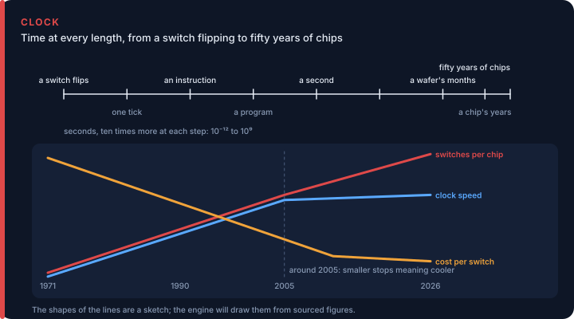

# What will be the next Moore's law?

> **The question behind it:** can any kind of progress keep doubling forever?

## Why it is open

For fifty years the number of switches on the best chips doubled about every two years: from 2,300 in 1971 to tens
of billions ([Karl Rupp](https://github.com/karlrupp/microprocessor-trend-data)). That is **fifty years of
doubling**. But **every doubling in the physical world has ended**: something else took over, or nothing did. Moore's
law was never a law of nature; it was a promise an industry kept by inventing. What it was really doubling, what is
left to double, and what might take its place, are open.

## What is true

**1. It was an observation that became a plan.** In 1965 Gordon Moore noticed that the number of parts on a chip was
doubling each year, and later settled on every two years. The industry then planned around it, so it held partly
because everyone worked to make it hold.

**2. For thirty years, smaller was better at everything.** When every length in a switch shrinks by the same factor,
the switch gets faster, uses less energy and costs less, all at once, at the same power for the same area (Robert
Dennard's rule of 1974). Shrinking was a free lunch.

**3. Around 2005, the lunch ended.** Switches kept shrinking but the voltage could no longer fall with them, because
too much current leaked through switches meant to be off. So the same area ran hotter. Clocks stopped getting faster
and chips got more cores instead. The number of switches kept doubling; the speed of one core mostly did not.

**4. Each generation now gives less.** A new process gives about 1.15 times the switches in the same area, 10 to 15%
more speed at the same power, or 25 to 30% less power at the same speed
([Tom's Hardware, TSMC](https://www.tomshardware.com/tech-industry/tsmcs-2nm-n2-process-node-enters-production-this-year-a16-and-n2p-arriving-next-year),
a claim). And each wafer costs more: about $4,000 at 16 nanometres against about $17,000 at 5 nanometres in 2020
([CSET](https://cset.georgetown.edu/article/analysts-believe-that-a-single-tsmc-5nm-wafer-costs-17000/), an
estimate). For the first time, a newer switch is not always a cheaper one.

**5. The names are no longer sizes.** "2 nanometre" names a generation, not a length you could measure. The pattern of
a silicon crystal repeats about every half a nanometre; a switch's channel is a few dozen atoms long.

**6. The switch keeps changing shape.** Flat, then fins standing up, then stacked sheets with the gate wrapped all
around. Each new shape gave the gate a firmer grip on the channel so the switch could shrink again. Next on the
research roadmaps: switches stacked on switches, then channels made of materials only a few atoms thick, projected
around 2033 and 2043 ([imec via TrendForce](https://www.trendforce.com/news/2026/07/09/news-imec-roadmap-extends-to-a3-by-2038-chip-density-gains-shift-beyond-traditional-transistor-scaling/),
[imec via Wccftech](https://wccftech.com/sub-1nm-process-node-technology-wont-arrive-till-2034-logic-roadmap-2dfets-sub-0-2nm-2046/),
projections).

**7. Going up instead of smaller.** Memory chips already stack hundreds of layers
([TrendForce](https://www.trendforce.com/news/2026/06/12/news-the-race-to-400-layer-nand-roadmaps-and-key-technologies-driving-samsung-sk-hynix-and-kioxia/));
processors stack memory on top; packages join many chips. Density can keep growing in the third dimension when it
can no longer grow in two.

**8. Doublings everywhere end.** Clock speed doubled, then stopped. Wafer size grew from the size of a coin to a
dinner plate, and the next step was shelved because every machine in every factory would have had to change. Cost
per switch fell for decades, and has slowed. Something else always took over: more cores, special units, stacking.

**9. What we ask for grows faster than what each answer costs.** Each answer costs less energy every year, and we ask
for ever more: data centres used about 485 terawatt-hours, projected to reach about 950 by 2030
([IEA via Enlit](https://www.enlit.world/library/ai-and-data-centre-electricity-use-continue-to-surge-iea-finds), a
projection).

## The visual system: Clock

**What it lays out:** **time, at every length**: one switch flipping (trillionths of a second), one tick of the clock,
one instruction, one program, a wafer's months in the factory, a chip's years of life, fifty years of chips. One
continuous scale of time, the way the dive is one continuous scale of space. Along the longest stretch, the lines
of what doubled: switches, clock speed, cost per switch, energy per answer, each bending where it bent.

**What you can do:** slide through the years and see the state of the art in each part of a chip, tagged by how
certain it is (shipping, announced, projected); hold a doubling up against the line and see where it stops matching;
place a dated forecast and wait for its date.

**What it shows that words cannot:** that every doubling is a straight line on a scale that grows tenfold at each
step, and that each line bends at its own moment.

**Status:** new. The first version of the lab had a roadmap to the 2040s and a time slider from 1971.

## The engine: Scaling

**What it computes:** what one generation smaller gives and costs: switches per area, speed, power, leakage, the cost
of a wafer and of each good chip, the masks and the design; and the long lines of each measure over the years, from
sourced figures.

**Its maths:** scaling rules (how speed, power and density follow a change of size, and where they stopped
following); compound growth; cost per good chip.

**What it decides:** what a step smaller gains for your chip; which doublings still hold; whether a forecast came
true.

**Today:** in part: the switch generation is a setting of your chip (`src/engines/chip.js`), with speed, heat,
leakage and the cost of a wafer; the dated figures are in `src/data/facts.json`, re-checked each month. A Scaling
engine of its own, with the long lines and forecasts, is missing.

## Questions inside

| Question | Something true to notice |
| --- | --- |
| Shrinking is slowing. What should double next: switches, usefulness, or something nobody measures yet? | For decades the switches on the best chips doubled about every two years. |
| Make the switch one generation smaller. What gets better, and what bill arrives? | The voltage no longer falls with the switch, so the same area runs hotter. |
| Flat, then fins, then sheets. What comes after the sheet? | Each new shape gave the gate a firmer grip on the channel. |
| When a channel is a few dozen atoms long, what is left to shrink? | Silicon's crystal pattern repeats about every half a nanometre. |
| When you cannot go smaller, do you go up? | Stacking shortens the distance data travels. |
| Shorter light prints smaller details. What happens when it cannot get shorter? | The newest machines gather light with larger mirrors instead. |
| This chip is made on purpose in an older process. When is smaller not better? | Memory that keeps its contents without power is hard to shrink; older processes are proven. |
| Each new factory costs more than the last. Can that keep rising faster than chips earn? | Only a few companies can still afford to build one. |
| Wafers grew from a coin to a dinner plate. Why stop there? | Every machine in every factory would have had to change. |
| Each answer costs less energy every year, yet we ask for more. Can the planet afford it? | Nearly all a data centre's electricity leaves it as heat. |

## Challenges

| Challenge | What you change | What the engine judges |
| --- | --- | --- |
| **One generation smaller.** What gets better, and what bill arrives? | the switch generation | speed, heat, leakage, cost |
| **Half as fast again**, with every signal on time. | clock, switch generation | speed; nothing late |
| **The bend.** Fit a line to fifty years of switches. Where does it stop fitting, and which other line takes over? | the line | how well it fits each stretch |
| **Forecast.** Make a dated claim about a measure (switches, cost, energy per answer). | your claim | scored when its date comes |

The first two exist today as a try and a challenge; the forecast needs forecasts in the record.

## Innovation direction: stacking, new switches, and new things to double

- **Stacking**: switches on switches (CFET), memory on logic, chips bonded to chips; density in three dimensions.
- **New switches**: channels made of materials a few atoms thick; power delivered from below the switches instead of
  through the wiring above.
- **New things to double**: work per joule instead of switches per area; answers per dollar; the usefulness of a
  chip for the jobs people actually run.

**The catch:** every option is harder and costlier than shrinking was, and none yet promises fifty years.

## Community topic: forecasts

A forecast is a dated claim about a measure: "by 2030, a chip will hold so many switches", "by 2033, an answer will
cost so much energy". The community keeps forecasts, with who made them and when, and scores them when their date
comes. The lab's own projections (each figure of the kind "projection" in its sources) are forecasts too, and are
scored the same way.

**How it is judged:** by the figure that arrives on the date, with its source.

## Real cases

- **Fifty years of doubling**: from 2,300 switches in 1971 to tens of billions
  ([Karl Rupp](https://github.com/karlrupp/microprocessor-trend-data)).
- **The first wrapped-around switches in volume**: TSMC's 2-nanometre generation, in production since late 2025
  ([Gigazine](https://gigazine.net/gsc_news/en/20260105-tsmc-2nm/)).

## Where it meets other questions

- **[make](make.md):** each smaller switch has needed new steps, more masks and costlier machines.
- **[limit](limit.md):** forecasts mark walls; some are physics, many are cost.
- **[divide](divide.md):** when shrinking slowed, special units and chiplets took over.
- **[open](open.md):** older processes are where most chips, and the open ones, are made.

## From earlier work

Fits and comes back: the roadmap and scenarios to the 2040s, tagged shipping, announced or projected; the time
slider from 1971; the transistor's shapes (planar, fin, gate-all-around, CFET); the switch generation try.
