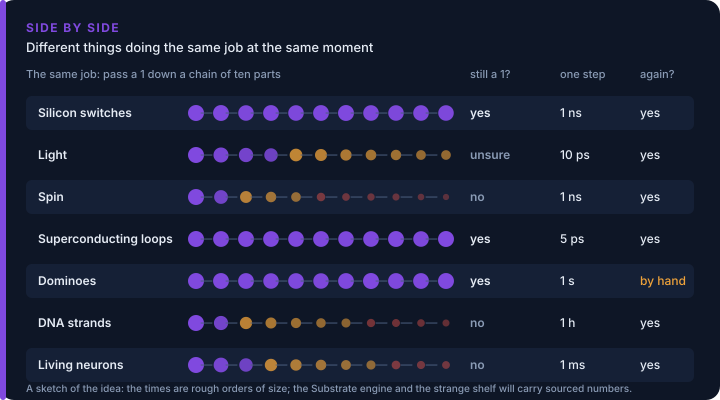

# What is the strangest thing that could compute?

> **The question behind it:** is computing something we invented, or something nature was already doing?

## Why it is open

**Almost anything with two states can compute.** Dominoes, marbles, water in pipes, beams of light, strands of DNA
and living cells have all been made into logic gates. But **almost nothing can do it fast, small, cheap and a
billion times in a row**. Silicon switches can, and that is why nearly every computer is made of them. The question
is not whether strange computers are possible. It is what a thing must have to compute in earnest, and whether
something else could have it in a way silicon cannot.

## What is true

**1. Two states are not enough.** A computer needs things that can be in distinguishable states, and a way for one
thing's state to change another's. Dominoes have that: a falling domino knocks over the next.

**2. The signal must survive being passed on.** Every real part adds a little noise and loses a little strength.
A part that only passes a signal on lets those errors pile up, until after a few steps nobody can tell a 1 from a
0. A part with **gain** (it puts out more than it takes in, drawing on a power supply) and a **threshold** (a weak
1 comes out as a full 1) cleans the signal at every step, so chains of any length still work. R. W. Keyes set these
out in 1985 as what makes a good computer device: gain, a sharp threshold, an output that can drive the next part
and is not disturbed by it.
([Science, 1985](https://doi.org/10.1126/science.230.4722.138))

**3. It must be able to do it again.** A row of dominoes can add two numbers, once. Then someone has to stand every
domino up. A computer resets itself billions of times a second, and the reset costs energy too.

**4. It must hold a state.** Computing needs memory: something that keeps its value until it is told to change.

**5. Then the numbers decide.** Once a medium can chain, store and reset, it is judged like any switch: how much
energy a step takes, how long, how much space, how often it is wrong, and whether a factory can make billions that
behave alike. Silicon is not the best at each of these. It is good enough at all of them at once, and sixty years
of factories make it cheap.

**6. Not all computing is logic.** Some computers let physics do the work directly. In an analog computer, voltages
stand for numbers and a circuit settles into the answer of an equation. In a quantum computer, qubits hold many
possibilities at once and interference steers them toward an answer some problems need. In a probabilistic computer,
bits that flicker on purpose settle into good answers to search problems. Each gives up exact steps for something
else.

**7. Nature computes already.** A cell reads its DNA and decides which proteins to make; a brain of about 20 watts
recognises faces ([The Physics Factbook](https://hypertextbook.com/facts/2001/JacquelineLing.shtml)). Neither has a
clock or a program in our sense. Whether to call that computing is part of the question.

## The visual system: Side by side

**What it lays out:** many kinds of matter doing **the same small job at the same moment**: passing a 1 down a chain,
adding two bits, or storing one, in silicon, light, spin, superconducting loops, dominoes, DNA and neurons. Each
lane shows the job happening at its own speed, with the same measures under every lane: energy for one step, time
for one step, space, how often it is wrong, and whether it can do it again.

**What you can do:** choose the job; add a lane; turn up the noise; ask for a chain of ten, then a hundred; watch
which lanes keep their 1 and which fade, which are fast and which wait, which need to be reset by hand.

**What it shows that words cannot:** that each medium wins somewhere and loses somewhere, at a glance, and that
the losses are what keep strange computers strange.

**Status:** live on the world's page: six lanes (silicon, superconducting loops, light, neurons, DNA, dominoes)
pass a 1 down a chain of ten, a hundred or a thousand parts, each at the pace of its own step, with energy, time
and reset under every lane and a source for each number. Still to come: the other jobs (adding two bits, storing
one), adding a lane, and the numbers still missing (light's, DNA's energy).

## The engine: Substrate

**What it computes:** any medium described by a few numbers: how its output follows its input (the curve), how
much noise each step adds, how long a step takes, what it costs in energy, whether it can reset. From these: does
a 1 survive a chain of them, and what does each step cost?

**Its maths:** a curve applied to itself again and again until it settles or fades; noise added at each step;
sums of energy and time.

**What it decides:** whether a medium can compute in long chains; which medium does a given job at the least energy
or time; whether a claimed new device is good enough to chain.

**Today:** exists in part (`src/engines/substrate.js`): the chain of curve and noise, as a model of the principle,
and each step's energy, time and reset from the media's numbers and their sources (`src/data/media.js`, the
first shelf). Missing: storing a bit, a device described only by its curve, and the jobs' own measures.

## Questions inside

| Question | Something true to notice |
| --- | --- |
| Dominoes, water and light can each build a logic gate. What makes something a computer? | Two states are not enough: the output must be strong enough to drive the next gate. |
| Dominoes can add. What can they not do twice? | Every domino has to be stood up again by hand. Resetting is part of computing. |
| Pass a 1 through ten gates. Which media still have a 1 at the end? | Only those with gain and a threshold, whatever they are made of. |
| Almost every chip is made of silicon. What else could it be made of? | Silicon won because it is cheap, can be made extremely pure, and grows its own insulating skin. |
| What could replace the switch itself? | Every candidate so far beats today's switch at something and loses at something else. |
| Could one atom be the switch? | A transistor built around a single atom has been made. It worked only near absolute zero. |
| Here is a switch that is slow, tiny and never forgets. What is it for? | New devices often come before the job that needs them. |
| A computer of living neurons is on sale. Is it a computer? | It learns from feedback; nobody programs it. |
| Is nature already computing? | A cell decides which of its genes to use, with no clock and no programmer. |

## Challenges

| Challenge | What you change | What the engine judges |
| --- | --- | --- |
| **Keep the 1.** Make a 1 survive a chain of a hundred parts with the least energy. | gain, threshold, energy per step | the 1 arrives; the energy spent |
| **Strange or not?** A new device is described by its curve, noise and speed. Can it compute in chains? | nothing: you decide, then run it | your verdict against the chain |
| **The right medium.** A job card (a sensor that must run ten years on a coin cell; a search with many good answers; a model of a molecule): choose the medium. | the medium | the measures that job cares about |
| **Shelve it.** Add a medium to the shelf with its numbers and their sources. | a new lane | the numbers chain or do not; the sources hold |

The first is played on the page (the lanes and the cooling); the others need a device described only by its
curve, job cards with their own measures, and a way to add a lane.

## Innovation direction: new media

Each bet keeps what a computer needs and changes what it is made of:

| Medium | What it gains | Its catch | How far it has come |
| --- | --- | --- | --- |
| Light | data moved without heating wires; multiply-adds as beams interfere | turning numbers into light and back costs energy and precision; light is hard to store | photonic processors installed in two European supercomputing centres ([EE Times](https://www.eetimes.com/q-ant-hits-full-production-capacity-for-photonic-ai-processors/)) |
| Superconducting loops | almost no energy lost per switch | everything must be colder than outer space, and the cooling costs energy | a target of about 100 times the efficiency, cooling included, is a projection ([Jefferson Lab](https://www.eurekalert.org/news-releases/1011158)) |
| Spin | a state that stays without power | small differences between on and off; hard to chain | spin memories in products; spin logic in labs |
| Bits that flicker | answers to search and sampling, cheaply | only some problems fit | first chips taped out ([Supercomputing News](https://www.supercomputing.news/emerging/thermodynamic-computing-first-silicon-power-math)) |
| Qubits | some problems, such as simulating molecules, become possible | qubits lose their state at the slightest disturbance; many physical qubits for each reliable one | error correction below threshold shown ([Willow](https://en.wikipedia.org/wiki/Willow_processor)) |
| DNA | storage dense enough to hold a library in a drop | slow to write and read | first commercial DNA storage planned for 2026, a claim ([Blocks & Files](https://www.blocksandfiles.com/architecture/2026/03/06/french-dna-coming-to-a-datacenter-near-you-soon/4093753)) |
| Living neurons | learning without a program | keeping cells alive; nobody knows how to scale it | a biological computer on sale, about $35,000 ([Live Science](https://livescience.com/technology/computing/worlds-1st-computer-that-combines-human-brain-with-silicon-now-available)) |

## Community topic: the strange shelf

A shelf of things that compute, each one a specimen: its curve, its noise, its speed, its energy, whether it can
reset, and the sources for each number. Anyone can add a medium, or correct one. Each specimen runs in the
Substrate engine, so the shelf is not a list of claims: it shows which ones chain, and at what cost. Claims that
failed stay on the shelf, marked.

**How it is judged:** sources for every number; the engine for whether it chains.

## Real cases

- **A computer made of DNA** (1994): Leonard Adleman solved a small route-finding problem by letting strands of DNA
  find each other in a test tube. It took days for a puzzle a person could do by hand; it showed that molecules can
  compute. ([Science, 1994](https://doi.org/10.1126/science.7973651))
- **A transistor made of one atom** (2012): a single phosphorus atom placed in silicon, switching current. It needed
  temperatures close to absolute zero. ([Nature Nanotechnology, 2012](https://doi.org/10.1038/nnano.2012.21))

## Where it meets other questions

- **[think](think.md):** the gap between 0 and 1 that makes silicon reliable is the threshold the Substrate engine
  asks of every medium.
- **[limit](limit.md):** every medium that erases information pays the same physical floor; only reversible
  computing does not.
- **[life](life.md):** neurons and cells are on this shelf as media; how they organize is a question there.

## From earlier work

Fits and comes back: the ten "new ways to compute", each with how it works, its catch and where it stands; the
two-qubit circuits; the probabilistic bits; light doing matrix multiplication. They become lanes and specimens
here, judged by one engine, instead of ten separate topics.
