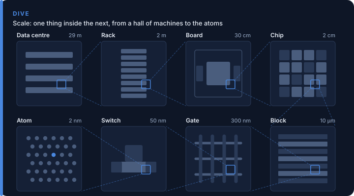

# How does a chip think?

> **The question behind it:** where does thinking come from: the parts, or how they are arranged?

## Why it is open

Two things are true at once. **Every part of a chip is simple and understands nothing**: a switch is on or off; a
gate compares two voltages; a memory cell holds one bit. And yet **the whole answers your question**, recognises a
face, or writes a sentence. Nothing in between is clever either. So the thinking is not in any part we can point
at. Asking where it is leads to asking what thinking is.

## What is true

**1. A switch that one voltage controls.** A transistor is a switch with no moving parts: a voltage on its *gate*
opens or closes a path for current between two other ends. Chips use two kinds that respond in opposite ways (one
conducts when the gate is high, the other when it is low). Put one of each together and you have the simplest
circuit that computes: an inverter, whose output is always the opposite of its input.

**2. On and off is a choice of reading.** A wire's voltage can be anything between zero and the supply. We agree
to read high as 1 and low as 0, and to leave a gap in between that means nothing. That gap is what makes chips
reliable: a slightly wrong voltage is still read the right way, and every gate pushes its output back to a clean
high or low. The same eight wires can be read as a number, a letter or the colour of a pixel. Nothing in the
switches says which.

**3. A few kinds of gate can build every rule.** Any rule that turns bits into bits can be written with AND, OR and
NOT. One gate is enough on its own: NAND (an AND whose answer is turned over) can be wired into AND, OR and NOT,
and so into anything. Claude Shannon showed in 1937 that circuits of switches follow the same algebra as logic.

**4. Arithmetic is logic.** Adding two bits gives a sum (1 when exactly one of them is 1: XOR) and a carry (1 when
both are: AND). Chain such adders, carry to carry, and you add numbers of any width. Subtraction, comparison and
multiplication are built the same way. A chip does not know numbers; it knows rules that happen to agree with
arithmetic.

**5. Memory is a loop.** Gates on their own forget: their output follows their inputs. Wire two inverters in a
ring, each feeding the other, and the pair holds whichever value it was last pushed into. Every register and
every on-chip memory cell is a loop of this kind.

**6. A clock turns logic into steps.** Signals take time to pass through gates, and different paths take different
times. So a chip lets the logic settle, then, on the tick of a clock, every loop takes its new value at once. A
chip is a huge machine that moves from one state to the next, billions of times a second.

**7. A program is data.** In a stored-program computer the instructions are numbers in the same memory as
everything else. The processor fetches one, decodes it, does it, and moves to the next. One machine can do any
job that can be written down; Alan Turing showed in 1936 that such a machine can compute anything any computer
can, given time and memory. RISC-V is an open set of such instructions anyone may build a processor for.

**8. A model that learned is mostly multiply-and-add.** Today's AI does not follow rules someone wrote. It runs a
very large set of numbers (*weights*) learned from examples, through the same operation repeated billions of
times: multiply two numbers and add the result to a running total. The chip underneath is the same logic as
before; what it does is set by the weights, which nobody wrote by hand.

**9. Every level is a full explanation in its own words.** A program explains what the chip does in terms of
instructions; the gates explain it in terms of logic; the transistors in terms of current; the atoms in terms of
electrons. None of these is wrong, and none contains the others' words. "Where is the thinking?" asks which level
the question belongs to.

## The visual system: the Dive

**What it lays out:** scale. One continuous zoom from a hall of machines down to the electrons in a crystal, each
depth living inside a small square of the one above: a data centre, a rack, a board, a chip, a block, a gate, a
switch, an atom. The same dive starts in a phone or a car and meets the others in the shared depths, because every
chip is built from the same kinds of cells and switches.

**What you can do:** go deeper or higher at any point and stop between levels; touch any part to learn what it
does. Planned: follow *one sum* down through every depth while it happens, from the instruction to the gates that
add, to the switches that flip, to the charge that moves.

**What it shows that words cannot:** that each depth is complete in itself and none of them is "where" the
thinking is. The question changes form at every depth instead of being answered at one.

**Status:** exists (`src/v2/level3d.js`, `src/app/world.js`): the strongest picture the lab has, and the bar every
other visual system is held to.

## The engine: Logic

**What it computes:** from a written description of what wires must be, the truth table it produces; the gates that
make it; how long its slowest path takes; how many switches it needs; whether a set of tests would catch a broken
wire. And a small RISC-V processor whose arithmetic unit is made of your own design, copied 32 times, running real
programs.

**Its maths:** Boolean algebra; simulation gate by gate; delay along paths; fault models (a wire stuck at 0 or 1).

**What it decides:** whether a design does its job on every input; whether a program gives the right answer on the
core you built.

**Today:** `src/engines/tinychip.js`, `src/engines/design.js`, `src/engines/alu.js`, `src/engines/core.js`,
`src/engines/riscv.js`, all tested. Missing: a tiny neural network run on the core, so learned behaviour can be
followed down the same levels as written logic.

## Questions inside

| Question | Something true to notice |
| --- | --- |
| How can on and off mean anything at all? | The same bits can be a number, a letter or a colour. Meaning is a convention, kept by everyone who reads them. |
| Can one kind of gate build every other? | NAND alone can: wire its two inputs together and it becomes NOT. |
| The same switches, wired another way, make another gate. Does meaning come from the wiring? | Every gate on a chip is made of the same two kinds of switch; only their number and joins differ. |
| Is remembering part of thinking, or something separate? | A memory cell is logic fed back into itself. |
| Why does a chip need a clock at all? | Without one, answers that arrive at different times would mix. A few chips do without one, at the cost of other machinery. |
| Is a program a machine, or something a machine reads? | The same processor runs any program; the program is numbers in memory. |
| A car's controller runs one small program for fifteen years. Is that thinking? | Most chips are small controllers like that, not big processors. |
| Is thinking just a great deal of adding? | An AI model is mostly multiply-and-add, repeated billions of times. |
| At which depth does the thinking begin? | Nothing at the depth of atoms knows it is part of a computer. |

## Challenges

| Challenge | What you change | What the engine judges |
| --- | --- | --- |
| **Only NAND.** Build a full adder from NAND gates and nothing else. | the description | right on all 8 inputs; how many gates you needed |
| **Make a bit remember.** Two gates, one loop: make it hold a 1 after the input goes away. | the wiring | the bit holds through a change of inputs |
| **Count.** Four flip-flops and some adders: count from 0 to 15 and start again. | the description | every tick adds one; the fastest clock it survives |
| **Your slice, 32 times.** Design one bit of an arithmetic unit; the core copies it 32 times and runs real programs on it. | the slice | the test programs give the right answers |
| **Tell a 7 from a 1.** A network of 16 weights, multiply-and-add only, run on the core you built. | the weights | how many of the test digits it gets right; how many additions it took |

The first four exist in the lab today (the studio's adders, the register bit, the ALU slice and core). The last
needs the network on the core.

## Innovation direction: machines that learn

For seventy years a chip did what a program told it, step by step. Now much of the work is learned behaviour run
on hardware built for it: very many multiply-and-add units side by side, memory placed beside them, and numbers
kept short (8 or even 4 bits) because learned models tolerate it. The bets that go further drop more of the old
design: computing inside the memory array itself, laying a whole model out across a wafer so data never travels
far, and hardware that keeps learning after it is made.

**How far it has come:** chips built for learned models are the fastest-growing part of the industry; the bolder
bets are in labs and early products (see [divide](divide.md) and [life](life.md)).

**The catch:** a learned model cannot explain its answer in the terms of the levels below it. The chip computes it
exactly, and nobody can say why the answer is that one.

## Community topic: the open computer

The lab's community builds one small RISC-V computer in the open, piece by piece: an arithmetic slice, a register
bit, a selector, a counter, a display driver. Each piece is a design someone wrote (a person, an AI, or both,
saying which), checked by the Logic engine, and placed in the shared plan. Anyone may break a piece by finding an
input where it is wrong, and anyone may make a piece smaller or faster. The record keeps all of it.

**How it is judged:** the engine runs every piece on every input it can take, and the core runs the test programs
on the pieces as they are.

## Real cases

- **An election with 4,096 extra votes** (Schaerbeek, Belgium, 2003): one bit of a memory cell flipped, most likely
  by a particle from space, and a candidate gained exactly 2¹² votes. A bit is a physical thing.
  ([Wikipedia: Electronic voting in Belgium](https://en.wikipedia.org/wiki/Electronic_voting_in_Belgium))

## Where it meets other questions

- **[strange](strange.md):** the gap between 0 and 1 in "What is true" (2) is what any material must provide to
  compute: the Substrate engine tests exactly that.
- **[idea](idea.md):** the same description seen here as a machine is seen there as a design that has to be made.
- **[divide](divide.md):** in a chip that runs a learned model, most of the energy goes to fetching the numbers,
  not to the multiply-and-add.
- **[limit](limit.md):** every gate that takes two bits and gives one throws a bit away, and physics charges for that.

## From earlier work

Fits and comes back: the studio's adders and voter; memory and the clock (the latch, the flip-flop, the counter
pushed until it breaks); the RISC-V lab with a custom instruction; the ALU slice copied 32 times; the dive and its
notes at each depth. Does not fit here: the comparison of x86, Arm and RISC-V as companies and markets (it belongs
to [open](open.md)).
