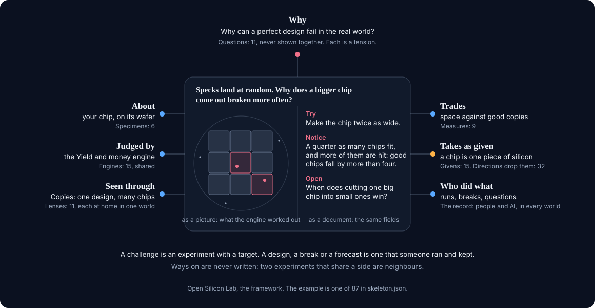
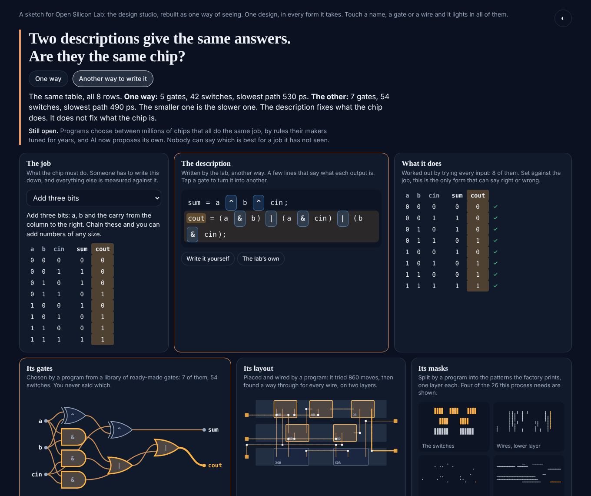
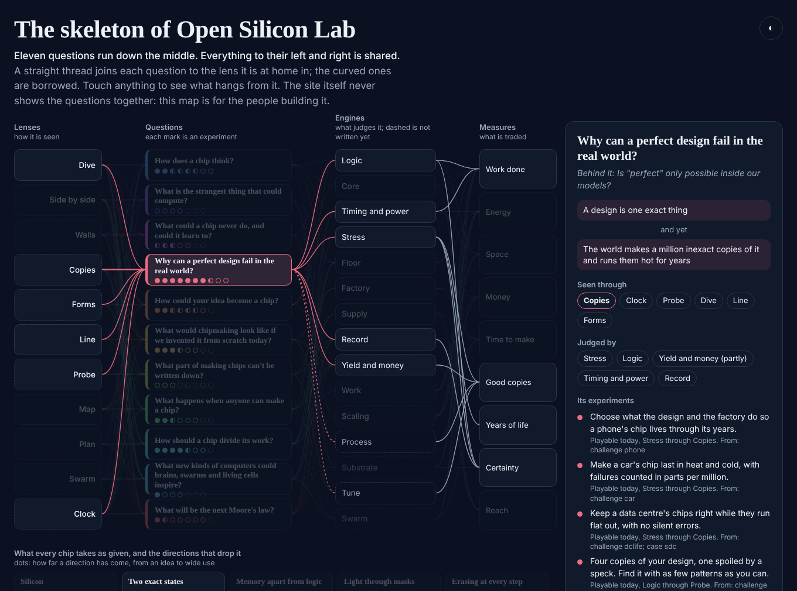
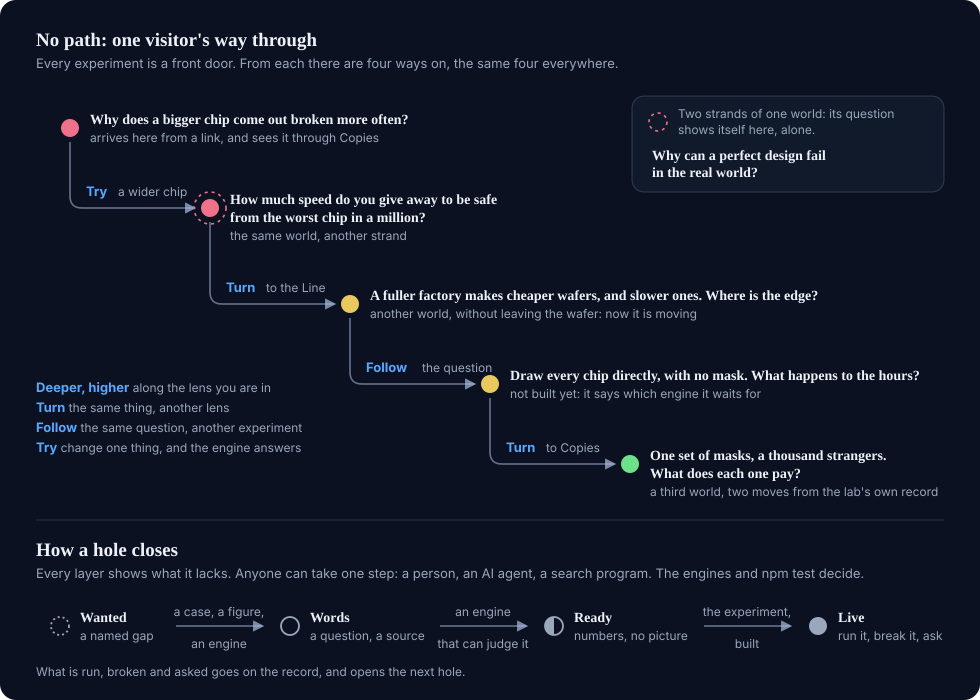

# The framework: a lab made of experiments

The skeleton of Open Silicon Lab: what every page, picture, challenge, engine and community contribution hangs
from. Written by Claude Fable 5.2 on 15 November 2026, at the owner's request, with freedom to change anything.

**Status.** These documents, the data file and the three pictures are merged. Nothing on the site has changed
yet. `docs/SYSTEM.md` still describes the site as it stands; this folder says what it is being rebuilt into, and
in which order.

| File | What it holds |
| --- | --- |
| this file | The summary, the idea, the layers, where I disagree, the decisions that are the owner's |
| [worlds.md](worlds.md) | The eleven worlds in full, with an honest count of what each has today |
| [shared.md](shared.md) | What the worlds share: lenses, engines, measures, specimens, givens and directions, the record |
| [growth.md](growth.md) | How the lab stays open: how a visitor moves, how anything new enters, how it holds at a hundred times the size |
| [rebuild.md](rebuild.md) | What fits, what is rebuilt (the design studio first), what goes, and the plan in stages |
| [skeleton.json](skeleton.json) | All of it as data. The map draws this file; `npm test` checks it against the repository |
| [map.html](map.html) | The skeleton as a map you can touch: worlds, lenses, engines, measures, givens, and what each world has today |
| [forms.html](forms.html) | A working sketch of one world's way of seeing: the design studio rebuilt, running on the lab's real engine |
| [atom.svg](atom.svg), [moves.svg](moves.svg) | The experiment and its seven sides; how a visitor and a contributor move |

The two HTML files open in any browser, straight from disk, in dark and light.

## The two-minute summary

**What is wrong.** The site is laid out like a chip: places, levels inside them, and a loop for the chip's life.
The questions were pinned onto that layout afterwards. So a picture shows a *thing*, the words beside it are a
*caption*, and the question is a *mark* on the thing. They are three systems because they are about three
different things. The card's three tabs (Look, Do, Ask) are those three systems, side by side. The design studio
is the clearest case: six small drawings in a strip, a card of text that says "Step 5 of 6", and a button called
*Next step*.

**The idea.** The lab is made of **experiments**. An experiment is the smallest piece of the lab, and it is the
only kind of piece:

> one small question, put to an engine, seen through one way of seeing.

The picture is what the engine worked out. The words are the question, what is true (checked by the engine, or
with a source), and what nobody knows yet. A challenge is an experiment with a target. A community design, a
break or a forecast is an experiment someone ran, kept on the record. So content, pictures, challenges and
contributions are made of the same thing, and an experiment reads just as well as a plain document, with no
picture at all. That is the test for every one of them.

**Seven sides, each a shared layer.** Every experiment says:

| Side | Layer | How many today | In one line |
| --- | --- | --- | --- |
| **Why** | Questions | 11, hidden | The core questions. Each is a tension between two things that are both true. |
| **About** | Specimens | 6 | The chip on the bench: the open computer the community builds, your design, your chip, three real kinds of chip. |
| **Judged by** | Engines | 15 (8 exist, 3 partly, 4 missing) | Tested models: the maths behind chips. They decide what is true and whether a challenge is met. |
| **Seen through** | Lenses | 11 | Ways of seeing. The dive is one. Each lays one thing out across the picture: scale, time, form, copies. |
| **Trades** | Measures | 9 | What a chip costs and gives: work, energy, space, money, time, good copies, years, certainty, reach. |
| **Takes as given** | Givens and directions | 15 and 32 | What today's chips assume (silicon, a clock, masks). A direction is a bet that drops one. This is the frontier. |
| **Who did what** | The record | 6 kinds of entry, 8 planned | What people and AI did with it: built, broke, tried, asked. The community is this, in every world. |

**The eleven questions stay, and stay hidden.** Each has a **world**: its experiments, its home lens, the engines
that judge them, what the community leaves behind there. Worlds overlap, because the layers are shared: one
engine serves several questions, one lens shows several. Those shared pieces are the connections. Eleven of
everything would have been eleven separate sites.

**The owner's eleven visual systems were nearly right.** Working from what a picture can lay out, I arrive at
eleven lenses, and each question has one as its home: the dive for *how does a chip think*, a clock for *the next
Moore's law*, a crowd of copies for *why a perfect design fails*. But a lens is never owned. The dive serves
nine worlds.

**It stays open because every layer shows its holes.** An experiment with no engine says so. An engine that is
missing is named, with what it must do. A hole is an invitation with a contract: bring this, and `npm test`
decides. A new question enters at the bottom, as someone's question at an experiment, and rises only if work
gathers under it.

**The honest count.** I wrote down 87 experiments the content already points to. **22 can be played today. 16
have an engine and wait to be built. 29 are only words. 20 need something the lab does not have.** Three worlds
(the strangest computer, what a chip could never do, what can't be written down) have nothing a visitor can do.
The owner's feeling that "without the fancy design, there's not much left" is right for those three, half right
for five, and wrong for three (fail, divide, and the design side of idea), where the engines are real.

**First to rebuild: the design studio**, as the lens I call *Forms*: one design shown in all its forms at once
(the job, the description, what it does, its gates, its layout, its masks), linked, so touching anything lights
it everywhere, and the questions sit *between* the forms where meaning can slip. [forms.html](forms.html) is a
working sketch on the lab's real engine.

**The plan** has six stages. The first two change no pictures: they turn what exists into experiments, and make
every world readable as a document from the same data. Then the studio, then one card with no tabs, then the
worlds one by one, strongest first.

## 1. What I found

I read the site's data, engines and words, and counted.

- **The words are thin where the owner feels it.** The eleven questions hold about 4,600 words between them, in
  one-line stops: a question, a note, sometimes a list of what people try. *What could a chip never do* has 172
  words. *What part of making chips can't be written down* has 274 and no engine.
- **The engines are the real content, and half of them cannot be seen.** Fifteen pure, tested modules. The
  physics floor (the least energy a step can take) has no picture at all; its words wait in a file. The stress
  model runs ten years of a chip's life and is reached through three challenges at the port.
- **The pictures show things, not tensions.** A gate in 3D is a good picture of a gate. None of the eleven
  questions is about what a gate looks like. *Why can a perfect design fail?* is about the gap between one exact
  design and a million inexact copies, and no picture on the site shows a million copies.
- **Content has four homes and they do not meet.** Parts with captions (146), stops (about 110), challenges (12),
  and the ledger. A debate is a fifth kind, the ways to compute a sixth, real cases a seventh. Each was added
  with its own shape, so each needed its own place on the card.
- **The studio is the earlier site's line, unchanged.** Six stations, walked in order. Nothing in it exists
  because a question needs it; the questions were attached to stations afterwards.

**Where I agree with the diagnosis I was given, and where I do not.** The brief said: the site is organized
around the chip, and the questions only decorate it. I agree with the second half. The first half I would put
differently. The chip is not the problem. Using the chip's *anatomy as the table of contents* is. A site laid
out by places and levels can only ever show you around. The chip should stay, as the **specimen**: the one thing
every experiment is about. That is what makes this one world and not eleven. What changes is what counts as a
piece of content: not a place, a level or a part, but something you can do to the specimen that shows a tension.

## 2. The atom: an experiment

**What it must have.** Nothing is an experiment without all of these; `npm test` will check it (stage 1 of the
plan).

| Part | What it is | Checked how |
| --- | --- | --- |
| **Ask** | One small question, in plain words, that the visitor can act on | It belongs to at least one of the core questions |
| **Setup** | A specimen, an engine, and what the visitor may change | The engine exists, or the experiment says which engine it is waiting for |
| **See** | One lens | The lens can draw this engine's state |
| **Notice** | One to three things that are true | Each is checked by the engine in a test, or carries a sourced figure. No other sentence may claim a fact |
| **Open** | What nobody knows yet, and which directions people are trying | Each direction is an item of the frontier, with a stage and a source |
| **Target** (optional) | A region the engine can judge: this makes it a challenge | The target can be reached, and the starting state does not meet it |
| **Ways on** | Never written by hand | Worked out from what it shares with other experiments |

**The same thing, two ways.** Here is one experiment as a document. Nothing is added for the picture; the
picture is another way to show the same fields.

> **Two descriptions give the same answers. Are they the same chip?**
> *The setup.* The full adder's carry, written two ways. Both pass every one of the eight input patterns.
> *Try.* Swap one for the other and watch the gates, the layout and the slowest path.
> *Notice.* Same table, different chip. The Logic engine builds one from 5 gates with a slowest path of 530
> picoseconds, and the other from 7 gates with 490: the smaller one is the slower one. (Checked by the engine.)
> The description fixes what the chip does. It does not fix what the chip is.
> *Open.* Programs choose between millions of chips that all do the same job, by rules their makers tuned for
> years. AI now proposes its own. Nobody can say which of them is best for a job it has not seen.
> *It trades* space and speed. *It takes as given* that a few people with closed tools make these choices.
> *Ways on.* The same design, where the factory spoils a copy. The same engine, another job. Who placed these
> cells?

On the site the same experiment is the picture in [forms.html](forms.html): the description, its gates, its
layout and its masks, tied together, with the numbers read off the engine.

**What an experiment replaces.**

| Today | In the framework |
| --- | --- |
| A stop (question, note, what people try) | An experiment that is only words yet: honest about it, and a call for an engine |
| A challenge | An experiment with a target |
| A *Try it* that changes your chip | An experiment (it always was one) |
| A story (a guided step-by-step) | A guided run of an experiment |
| A debate (views and their assumptions) | An experiment seen side by side: each view's assumptions are the settings |
| A way to compute | A direction, with a specimen on the strange shelf |
| A real case | A run that the world did, with its source |
| A design, a break, a try in the ledger | A run someone kept |
| A part and its caption | A label. It names what you touch. It is not content |

## 3. The layers, and why each exists

A layer earns its place if taking it away breaks something. I tested each that way.

- **Questions** exist so that nothing is in the lab without a reason. Take them away and the lab is a tour.
- **Experiments** exist so that words, pictures, challenges and contributions are one kind of thing. Take them
  away and you have today's site.
- **Engines** exist so that what the lab says is true, and so that a challenge can be judged without a person.
  Take them away and the lab is an illustrated essay. They are also where AI agents and people meet as equals:
  the engine does not care who is asking.
- **Lenses** exist because a tension needs the right thing laid out across the picture to be seen. Take them
  away and every picture is a picture of an object.
- **Measures** are the joints. One engine's result is another's limit: the size that the Timing engine likes is
  the size the Yield engine punishes. Take them away and engines cannot be combined, every challenge invents its
  own gauges, and two worlds have nothing to exchange.
- **Specimens** exist so that every experiment is about the same few things, and what you change in one shows in
  the others. Take them away and each experiment is a toy of its own.
- **Givens and directions** are the frontier with a shape. Today "what people are trying" is a list of phrases
  under some stops. A list of technologies is a textbook chapter. But every chip rests on a few things taken as
  given, and every new direction is a bet that drops one or two of them. That turns the frontier into something
  you can stand on and ask: *what is this experiment taking as given, and what if it did not?*
- **The record** exists because the lab is built by people and AI together, and what they do must outlast the
  visit and count. It is not a layer of topics. It is on every experiment.

The owner proposed five layers of eleven. I kept all five ideas and changed their shape:

| The owner's layer | Here | Why changed |
| --- | --- | --- |
| 11 core questions | 11 questions, each stated as a tension, each with three to five strands | Unchanged in number and in words. A question alone cannot hold a world: it needed its strands |
| 11 visual systems | 11 lenses; each world has one as its home, and borrows others | So the same lens joins several worlds. The dive was already doing this |
| 11 physical engines | 15 engines, shared | An engine follows the maths, not the question. Queueing theory serves the factory wherever a question meets it |
| 11 innovation directions | 15 givens, and 32 directions that each drop one or two | A direction crosses questions. Chiplets belong to three |
| 11 community topics | One record, the same few moves in every world | Eleven topics would be eleven forums. The community is what happens to experiments |
| | Experiments, specimens, measures (new) | The atom was missing, and so were the thing it is about and the units it speaks in |

## 4. The eleven worlds, in one table

Each is written out in [worlds.md](worlds.md). The count is of the experiments in `skeleton.json`: playable
today · engine ready · only words · needs something missing.

| The question (never shown as a list on the site) | Its tension | Home lens | Engines | Today |
| --- | --- | --- | --- | --- |
| How does a chip think? | Every part is simple and understands nothing ↔ the whole answers you | Dive | Logic, Core, Timing, Floor | 2 · 4 · 2 · 0 |
| What is the strangest thing that could compute? | Almost anything can compute ↔ almost nothing can do it a billion times in a row | Side by side | Substrate (missing), Floor, Work | 0 · 0 · 4 · 3 |
| What could a chip never do, and could it learn to? | Some walls are laws ↔ many were money, habit or a lack of ideas | Walls | Floor, Logic, Scaling | 0 · 3 · 2 · 2 |
| Why can a perfect design fail in the real world? | One exact design ↔ a million inexact copies, run hot for years | Copies | Stress, Logic, Yield and money, Timing, Record | 7 · 1 · 2 · 0 |
| How could your idea become a chip? | An idea is free and vague ↔ a chip is exact and frozen | Forms | Logic, Core, Timing, Yield and money, Record | 2 · 4 · 1 · 1 |
| What would chipmaking look like if we invented it from scratch today? | Today's way is astonishingly good ↔ it is one path among many | Line | Factory, Process (missing), Yield and money | 3 · 1 · 2 · 2 |
| What part of making chips can't be written down? | What is written ↔ what is known by hands | Probe | Tune (missing), Record, Factory | 0 · 0 · 3 · 5 |
| What happens when anyone can make a chip? | A few ↔ anyone | Map | Supply, Yield and money, Record, Logic | 2 · 1 · 3 · 2 |
| How should a chip divide its work? | One general thing ↔ many special things that must keep talking | Plan | Work, Timing, Yield and money, Floor, Supply | 4 · 1 · 2 · 1 |
| What new kinds of computers could brains, swarms and living cells inspire? | One clock, one program, one designer ↔ no centre at all | Swarm | Swarm (missing), Record, Floor, Stress | 1 · 0 · 3 · 3 |
| What will be the next Moore's law? | Fifty years of doubling ↔ every doubling has ended | Clock | Scaling, Yield and money, Timing, Floor, Record | 1 · 1 · 5 · 1 |

*[map.html](map.html) is this picture, to touch.*

I kept all eleven questions and their words. I looked for what they leave out, and found three things the
content keeps reaching for: trust in a chip nobody fully understands, what chips cost the planet, and who
depends on whom. Each has a home today as a strand of an existing world (limit, scale, open). The framework says
how a strand becomes a twelfth question ([growth.md](growth.md)); I did not add one by decree, because a
question that arrives with work under it is worth more than one I name.

## 5. How anyone moves

There is no path. From any experiment there are four ways on, the same four everywhere:

| Move | What stays | What changes |
| --- | --- | --- |
| **Deeper · higher** | the lens | where you are along it: in or out, the step before or after, slower or faster |
| **Turn** | the thing you are looking at | the lens: the same gate as designed, as printed, as a million copies, over ten years |
| **Follow** | the question | the experiment: the nearest two in the same world, never a numbered trail |
| **Try** | everything | one setting, or one given dropped, and the engine answers |

*Turn* is the move the site once had as a switch (Designed · Made · Used) and that my structure review folded
into the loop. It comes back as the general sideways move, because it is where the worlds meet: you turn from
one lens to another and you are in another question's home, looking at the same thing.

An AI agent moves the same way: the open port's `look` returns an experiment and its four ways on.

## 6. Where I disagree

**With the owner.**

1. *Eleven of each.* Argued above. The number that matters is one: one kind of piece.
2. *Eleven community topics.* The community is not topics, for the reason you gave me yourself: it is not a
   section. What differs between worlds is what the community's work leaves behind there (a case book, a shelf of
   strange machines, forecasts that come due). The moves are the same everywhere.
3. *"I'm OK with document only."* I would go further. Document-only is not a fallback, it is the permanent test.
   Every experiment must be worth reading with the pictures switched off, and a lens is added only when it shows
   something the document cannot. Stage 2 of the plan builds exactly that reading view, before any new picture.
4. *The loop as the main thread.* You half doubted it ("technology does not all start with a need"). I now think
   the loop should not be the thread at all. It is one lens, the Line, at its widest. A chip's life is a true
   and useful order. It is not the reason anything is in the lab.

**With the brief I was given.**

1. *"Organized around the chip" as the fault.* Half right; see section 1. The chip stays, as the specimen.
2. *The table's ways of seeing.* Four changed. A perfect design fails because there are many copies, so its
   picture is the crowd, with years as its clock, not a lifeline. An idea does not *flow* to masks: all its forms
   exist at once and stay tied together, and showing them as a flow is what made the studio a line. What can't
   be written down is seen by probing a thing you cannot open. And the next Moore's law needs time at every
   length, from one tick to fifty years, not only a slider from 1971 to 2040.
3. *A frontier and a community column per world.* Both are shared, not per world (section 3).

**With my own earlier reviews.**

1. *The structure review* made the grid (a chip's life across, scale down) the whole interface. That grid is
   two of eleven lenses. Making it the structure is what cemented "a tour of the chip". Its two moves were
   right and survive, generalized.
2. *The same review* made one card with three faces. Three faces kept three systems alive behind one border.
   An experiment has no tabs.
3. *The same review* gave the commons a stage of the loop (Open) and a place (the Lab). You said the community
   is not a section; a stage is a section with an arrow. Here it has no place of its own. The Lab stays as
   where the *record* can be read whole.
4. *The community review* said "a challenge and a question are two faces of one thing". That was the idea in
   this document, and I stopped one step short of it: I joined the two with a link and left them as two.
5. *The art and transition reviews* made levels join without a cut. Good, and kept. They never asked what a
   picture is for, so they polished pictures of objects.
6. *Six kinds of view* (map, flight, dive, stack, line, bench) were kinds of *drawing*. A lens is a kind of
   *seeing*: it is named by what it lays out. The flight and the flat dive are one lens. The bench was never
   a way of seeing; it was a place to put a form.

## 7. Decisions that are the owner's

I decided everything I could. These four I should not.

1. **The first screen.** The island is good and liked, and in the framework it is the Map lens showing the lab's
   own world. The alternative the framework points to is the open chip itself in the middle of the screen,
   alive, with one experiment put to you ("this passed every test: would you ship it?"). I recommend keeping the
   island until three worlds are rebuilt, then trying both with people. Nothing in the plan before stage 5
   depends on it.
2. **May any shared layer be shown as a whole set?** Your rule covers the questions. I extended it to the
   lenses (the site never shows all eleven as a menu: a turn offers only the lenses the thing in view has),
   because eleven lenses in a row would be the eleven questions in disguise. But I think the **givens** should be
   shown together, as one page: *fifteen things every chip takes as given*. It is the clearest invitation to
   think differently that the lab could offer, and it is not a list of questions. It is close enough to your
   rule that it is yours to allow.
3. **People who have made chips.** The world of *what can't be written down* cannot be filled by me or by any
   AI: it needs stories from people who have worked in a factory or taped out a chip. Whether and how to invite
   them is yours.
4. **Publishing this folder with the site.** These pages open from disk and from the repository. Showing them
   at the site's address needs one line in the deploy workflow. I tried to add it in a pull request of its own;
   see the note at the end of [rebuild.md](rebuild.md) for whether it went through.

## 8. What I looked at

Checked today unless marked *from memory*.

- **A world from few rules.** The makers of *Breath of the Wild* described "multiplicative gameplay": actions,
  objects and terrain multiplying into situations nobody wrote, on a "chemistry engine" with three rules
  (elements change materials, elements change each other, materials do not change each other), which its
  technical director called "extremely simple" and able to express "all sorts of events"
  ([Thumbsticks on the GDC 2017 talk](https://www.thumbsticks.com/gdc-17-breaking-conventions-breath-of-the-wild),
  [and on its second part](https://www.thumbsticks.com/gdc-17-breath-of-the-wild-science-lies)). The lesson
  here: do not write content, write rules that meet. Engines, specimens and lenses are the lab's rules.
- **A log that shows only what you met, and where more waits.** *Outer Wilds* keeps entries with rumours (heard)
  and facts (seen), a mark for "more to explore", and a few large "curiosities" that colour the entries
  belonging to them ([the game's modding guide to its ship log](https://nh.outerwildsmods.com/guides/ship-log)).
  The curiosities are its core questions: coloured hubs you grow toward, never a list you are handed.
- **Many hands on one proof, without trusting each other.** Terence Tao's account of formalizing a proof in
  Lean with a "blueprint": a graph of every step, each coloured by its state (stated, ready to be proved,
  proved), so that anyone can take one open step without understanding the whole, and the checker, not
  reputation, says whether it holds
  ([his short tour, 2023](https://terrytao.wordpress.com/2023/11/18/formalizing-the-proof-of-pfr-in-lean4-using-blueprint-a-short-tour)).
  This is the model for holes: a hole has a state and a contract, and an engine closes it.
- **Exhibits you do, with no route between them.** The Exploratorium's Science Snacks are tabletop versions of
  its exhibits, tested by teachers, more than a thousand of them
  ([Ecsite on Science Snacks](https://www.ecsite.eu/node/20939)). Each is written as what to do and notice,
  then what is going on, then how to go further (*the section names from memory*). An experiment here has the
  same three beats: try, notice, open.
- **One design in several forms.** The Gajski–Kuhn Y-chart (1983) draws a chip design in three domains,
  behaviour, structure and geometry, at several levels of detail each
  ([Wikipedia](https://en.wikipedia.org/wiki/Gajski%E2%80%93Kuhn_chart)). Designers move between them all the
  time. The studio showed them as a queue.
- **A circuit nobody could explain.** Adrian Thompson evolved a circuit on a real chip in the 1990s to tell
  two tones apart. It used 37 of 100 cells; five of them were connected to nothing and it failed without them;
  it did not work on another chip of the same type
  ([Damn Interesting, "On the Origin of Circuits"](https://www.damninteresting.com/on-the-origin-of-circuits/)).
- **Knowledge that does not travel on paper.** Harry Collins found that no scientist built a working TEA laser
  from written sources alone; it took contact with someone who had built one
  ([a course summary of *Changing Order*](https://sites.google.com/site/drtimthornton/courses/tacit-knowledge/collins)).
  Intel's *Copy Exactly!* matches a new factory to the old one down to equipment and chemical purity
  ([Wikipedia](https://en.wikipedia.org/wiki/Copy_Exactly!)).
- **Why chips are printed, not drawn.** Tennant's law: for writing patterns point by point, throughput falls
  with the fifth power of resolution, so halving the feature size costs a factor of 32
  ([Semiconductor Engineering](https://semiengineering.com/tennants-law-part-2)).
- *From memory, not re-checked today:* Bret Victor's "explorable explanations" and "ladder of abstraction";
  Wikipedia's red links (a link to a page that does not exist yet is an invitation to write it); Polymath
  (open problems worked in public by many); forecasting sites where dated questions resolve; Robert Keyes on
  what a logic device needs (gain, so a signal is restored at every stage); Wright's law (cost falls by a
  steady fraction each time the total ever made doubles); Polanyi's "we know more than we can tell".
