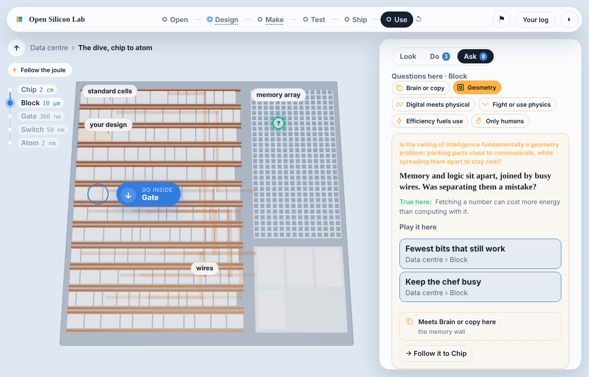
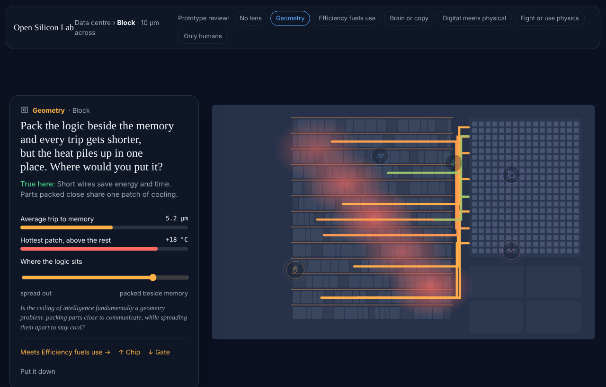

# The thirteen as the spine

A plan, 22 November 2026. Its decisions are the owner's; the review behind them is Claude's. It carries out the owner's decision of 20 November: the whole site restructured on the thirteen core questions as its framework, meaning everything connected to and behind the questions, presented visually and interactively, designed together as one system.

## Why

The lenses (#279) filed every experiment and challenge under the thirteen, but the lab still has four question systems side by side, and the thirteen are the thinnest of them on screen:

| System | Size | Where it shows |
| --- | --- | --- |
| The eleven earlier threads | 115 stops, 11 documents in `content/`, the grid of 104 cards at `#/w` | the dive's stops, the worlds' pages |
| The questions from the field | 40 (11 limits, 12 leaks, 17 bets), each with a real asker and a source | seams, *Questions here* |
| The thirteen core questions | 13 lenses | text cards under Ask; the picture barely changes |
| Puzzles, debates, searches | 2, 12, 20 | their own places |

About 370 texts on screen end in a question mark. Stops reach the thirteen only through their whole thread (`THREAD_HOME`), and the field questions are not filed at all. Under Ask, a row of up to six core-question names sits above the lens card, close to showing them together.

## Decided (22 November)

The first three came with the plan; the last three were settled the same day, before their tasks were unblocked.

1. **Marks on the picture replace the row of names.** A core question is met on the picture, where it lives, one at a time. Tapping its mark opens that lens alone.
2. **The eleven worlds are refiled, their documents kept as source.** Every stop is filed under the thirteen; the eleven stop being a structure a visitor meets; `#/w/<id>` stays as a reading page opened from a lens.
3. **The field questions lead.** Where one lives at a level, it is the first form its core question takes there: a real person, stuck, with a source.
4. **At most three marks while looking.** In Look, only the three strongest lenses at a level have marks; with Ask open, every lens that lives there does (at most six) (#303).
5. **The Beyond computation lab starts physical.** First a gate built from dominoes, water or light (anything can compute), then the program nobody can judge (#307).
6. **People and AI choose side by side.** In *A thousand that pass*, agents can make the same choice through the open port, marked as AI, and the lab shows the two groups apart (#309).

## The design

One spine, three layers:

- **The thirteen**, hidden, each a lens with a visual language of its own that repaints any picture.
- **Its forms at each level:** the field question that lives there first, then the stops. Each is filed once (`FILED.field`, `FILED.stops` in `src/data/frame.js`).
- **What you do with it:** the challenges, experiments and puzzles, already filed.

A lens, when on, has: the repaint; its form here as the caption; *true here*; one measure and one control from an engine; the core question behind it, small; the one lens it meets here; and ↑ ↓ that keep it on while moving level.

The prototype (`spine/lenses.html`, open it in a browser) shows the block level with its six lenses: Geometry (wires by length, heat as parts pack close), Efficiency fuels use (fetches against sums, and the rebound), Brain or copy (memory inside the logic, and the copy that drifts), Digital meets physical (a wire's voltage against the line where 1 begins), Fight or use physics (margins, or currents that add), Only humans (who decided each part). Its numbers are placeholders; on the site every number comes from an engine or `src/data/facts.json`.

The other seven lenses' visual languages, to build once the block is approved: Perfect fails, copies that differ; Whole beats parts, spares and votes; Compute beats cleverness, search against design; The next Moore's law, the same part a generation on; Fixed or fluid, what is fixed and what can change; Trust without inspection, what is checked and what nobody checked; Beyond computation, what computes here and what nothing can.

## Where two meet (added 22 November)

Holding two lenses at once shows where they meet, in one of three shapes: a **front** (two measures against each other, today's best compromises as a line, an innovation that moves it; only where one engine computes both), a **fork** (the same thing built two ways, split by a line you drag), a **chain** (one level's problem becoming the next). Each pair has a question neither lens asks alone. The pairs, today `SEAMS`, are renamed `MEETS`. Prototype: `spine/seams.html`; task #315, after #304, which now asks every lens to paint from facts the parts carry, so that two paints can be drawn together.

## Labs for the thinnest questions

Counted by challenges filed under each as home: Compute beats cleverness 1, Beyond computation 1, Fight or use physics 2 (both about fighting it), Only humans 2. Each gets a lab that faces its question directly:

- *Design it, or search for it?* (Sutton) at the studio's gates: search against a person's design as compute grows, and where an incomplete checker lets search "win" wrongly.
- *The program nobody can judge* (Turing) at the Lab: fool an agent that claims to know whether a program stops, on the community's RISC-V core.
- *Let the noise compute* (p-bits) at the switch: physics doing the work, with the waiting p-bits engine.
- *A thousand that pass* at the studio's job: a program makes many designs that all pass; the choice, and its reason, kept in the ledger.

## Parts and order

| # | Task | Group | Waits for |
| --- | --- | --- | --- |
| #302 | Refile every question under the thirteen; the field questions lead | `spine-file` | none |
| #303 | Marks on the picture open a lens; the row goes | `spine-lens` | #299, #302 |
| #304 | Lenses repaint the picture: the block level's six | `spine-lens` | #303 |
| #305 | The eleven worlds become reading pages | `spine-pages` | #299, #300, #303 |
| #306, #307 | Labs: search or design; the program nobody can judge | `labs-a` | #300 |
| #308, #309 | Labs: p-bits; a thousand that pass | `labs-b` | #300 |

The foundation pass (#298 to #301) goes first, because the spine's tasks touch the files it splits. Then option 2 of the review: the core visual systems, which the lenses' visual languages feed.
